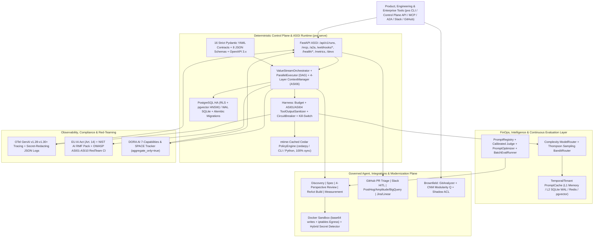

# AI-Native Product Value System

<div align="center">

[](https://www.python.org/)
[](LICENSE)
[](#roadmap)
[-6B46C1?style=for-the-badge)](docs/POLICY_SYNC.md)
[](docs/security/vulnerability-management.md)
[](tests/README.md)

**A research-backed, production-hardened reference implementation for governed, FinOps-optimized, AI-native software delivery — from problem discovery to verified release, enterprise governance, and post-launch outcome learning.**

[Quick Start](#quick-start) • [Architecture](#architecture) • [Empirical Benchmarks](#empirical-benchmarks) • [Limitations & Non-Goals](#known-limitations--non-goals) • [CLI & SDK](#python-sdk--cli-examples) • [Documentation](#documentation)

</div>

---

## Executive & Technical Value Proposition

Most AI coding tools accelerate *code generation* while leaving architecture, governance, security, FinOps cost control, and business outcome verification behind. The **AI-Native Product Value System** demonstrates how to engineer a **deterministic control plane** around **probabilistic AI agents** across the complete product lifecycle:

> `Problem → Discovery & Evidence → Specification → Parallel Multi-Agent Review → Iterative ReAct Build → Progressive Release → Post-Launch Outcome Learning`

### Why Teams Adopt This Architecture
- **Production Multi-Tenant ASGI Control Plane & Open Protocols**: Runnable via `pvs serve` (`FastAPI` + `uvicorn` + multi-target non-root `Dockerfile`), providing tenant-isolated durable HITL runs (`PostgreSQL` HA + RLS + atomic `FOR UPDATE SKIP LOCKED` approvals + `Alembic`), **Cedar-governed MCP JSON-RPC 2.0** (`POST /api/v1/mcp` with JSON Schema validation, RBAC agent allowlists, and RFC 9728 `/.well-known/oauth-protected-resource`), and **A2A Agent Cards & Tasks** (`/.well-known/agent.json`, `/api/v1/a2a/*`).
- **Deterministic Governance & OWASP Agentic Top 10 (ASI01–ASI10)**: Every agent runs inside a governed `Harness` enforcing **Cedar least-privilege policies** (100% verified parity, optional Rust `cedarpy` PyO3 backend), **16 strict Pydantic v2 YAML config contracts**, **8 JSON Schema 2020-12 artifact contracts**, live **`ToolOutputSanitizer` (OWASP ASI01/ASI04)** blocking indirect prompt injection, tool poisoning, and zero-width unicode smuggling, **4-layer SHA-256 tamper-evident `ContextManager` (ASI06)**, **`SignedAgentEnvelope` (ASI07)**, **automated ASI01–ASI10 CI Red-Teaming**, and **EU AI Act (Annex IV / Art. 14) + NIST AI RMF Governance Pack export (`pvs governance export`)**.
- **Measured FinOps, Bandit Routing & Semantic Intelligence**: Combines **native Structured Outputs & Prompt Caching** across Anthropic/OpenAI/Gemini, **temporal/tenant/version-scoped exact + semantic caching (`L1 Memory` / `L2 SQLite WAL` / `Redis` / `pgvector` HNSW)**, **Thompson Sampling `BanditRouter` + 6-feature complexity routing** (**90.8% cost reduction** vs. flagship), **calibrated LLM-as-a-Judge & automated prompt optimization**, **30%–50% discounted batch evaluations**, and **NetworkX DAG parallel execution** (**2.0x** speedup).
- **Enterprise PDLC/SDLC Integrations & Iterative ReAct Build**: Includes **HMAC-signed GitHub Pre-Human PR Triage** and **Slack Block Kit HITL approval webhooks** (with 1 MiB body-size DoS caps), **PostHog/Amplitude/BigQuery analytics connectors**, **Jira/Linear/GitHub Issues bidirectional sync**, **iterative ReAct `BuildAgent`** with unified diffs & safe base64 sandbox writes, and **Brownfield Modernization** (Git temporal forensics + Clauset-Newman-Moore modularity $Q = 0.7336$ + shadow ACLs).
- **Non-Punitive DORA AI 7-Capabilities & SPACE DevX Telemetry**: Tracks AI rework/churn, PR first-pass rate, cycle time, deployments, and satisfaction surveys with enforced `aggregate_only: true` and `anonymize: true` privacy contracts exported to Prometheus (`/metrics`), Grafana (10-panel dashboard), and `/devx`.

---

## Architecture



Explore full C4 (L1–L3), sequence, trust-boundary, and deployment diagrams in [docs/ARCHITECTURE.md](docs/ARCHITECTURE.md), [docs/architecture/DIAGRAMS.md](docs/architecture/DIAGRAMS.md), and [docs/adr/README.md](docs/adr/README.md) (`ADR-0001` through `ADR-0006`).

---

## Quick Start

Get verified diagnostics and runnable demos in under **2 minutes** at **$0.00 external API cost**.

### Using Make (Recommended)

> **Platform Note**: Works natively on Linux and macOS; on Windows, use WSL/Git Bash or run the direct Python commands below in PowerShell.

```bash
# 1. Install dependencies, initialize .env from .env.example, and configure git hooks
make dev-setup

# 2. Run environment, config contract, Cedar policy & schema diagnostics
python -m product_value_system doctor

# 3. Run greenfield demo offline at $0 cost using deterministic Mock adapter
make demo USE_MOCK=1

# 4. Run zero-cost showcases (FinOps, Brownfield Modularity, Parallel DevX)
python examples/showcases/finops_optimization_demo.py
python examples/showcases/brownfield_modernization_demo.py
python examples/showcases/parallel_devx_demo.py

# 5. View all 23+ developer targets
make help
```

### Without Make (Direct Python / CLI)

```bash
git clone https://github.com/vfcarida/AI-Native-Product-Value-System.git
cd AI-Native-Product-Value-System
pip install -e ".[dev]"

# Verify all 14 YAML configs, 8 JSON schemas, and Cedar policy engine
pvs doctor --json

# Inspect FinOps model routing for any prompt
pvs route --prompt "Convert CSV rows to JSON schema" --task-type format_conversion

# Analyze git hotspots & Strangler Fig boundaries on any repo
pvs brownfield --repo . --days 90 --strangler

# Run full greenfield value stream (offline Mock mode or with OPENAI_API_KEY / ANTHROPIC_API_KEY)
pvs run examples/greenfield/problem_payment_flow.yaml
```

---

## Python SDK & CLI Examples

Top-level lazy exports (`product_value_system`) expose the core control plane directly:

```python
from product_value_system import (
    CircuitBreaker,
    DevXTracker,
    ModelRouter,
    PolicyEngine,
    PromptCache,
    validate_all_configs,
)

# 1. Fail-fast startup validation across all 16 config/*.yaml contracts
report = validate_all_configs("config", expand_env=True)
assert report.is_valid, report.errors

# 2. Complexity-aware FinOps model routing
router = ModelRouter.from_yaml("config/routing.yaml")
decision = router.route(
    [{"role": "user", "content": "Extract HTTP status codes from this log line."}],
    task_type="extraction",
)
print(f"Routed -> {decision.provider}/{decision.model} (tier={decision.complexity_level.value})")
```

Sample output from `pvs doctor`:
```text
PVS Doctor v1.0.0 — HEALTHY
  [OK] python_runtime: Python 3.12.10
  [OK] yaml_config_contracts: 16 configs valid
  [OK] cedar_policy_engine: Loaded agent_authorization.cedar (cached=False)
  [OK] json_schemas: 8 schema file(s) in schemas
  [OK] llm_provider_credentials: No live API keys set (offline mock mode ready at $0 cost)
```

---

## Empirical Benchmarks

Measured deterministically at **$0.00 external API cost** via [`scripts/run_benchmarks.py`](scripts/run_benchmarks.py) (200 iterations, reporting tail latencies p50/p95/p99 per NeurIPS / HELM / FinOps Foundation standards). Full methodology and environment fingerprint in **[docs/BENCHMARKS.md](docs/BENCHMARKS.md)**.

| Subsystem | Metric | Measured Result | Tail Latency (p95 / p99) |
|---|---|---:|---:|
| **Cedar Policy Engine** | Auth throughput & mtime-cache init speedup | **163,840 eval/s** (`32.1x` warm init) | `0.0062 ms` / `0.0129 ms` |
| **Hybrid ML Secret Detector** | 17K-token clean doc scan (0 FP, `2/2` probes) | **2.59 ms** p50 (`0` FP) | `3.18 ms` / `3.18 ms` |
| **Prompt Cache (L1 Memory)** | Exact-match lookup latency | **0.0096 ms** p50 (`60%` proj. savings) | `0.0278 ms` / `0.0433 ms` |
| **Prompt Cache (L2 SQLite WAL)** | Persistent WAL exact-match lookup | **0.276 ms** p50 (zero-write reads) | `0.523 ms` / `0.817 ms` |
| **Complexity Model Router** | Routing throughput & FinOps savings | **4,551 req/s** (**90.8%** savings vs. flagship) | `0.2791 ms` / `0.3545 ms` |
| **Parallel Agent Orchestrator** | 6-agent DAG (`4` concurrent reviewers) | **2.0x** speedup (**50.0%** faster) | `141.0 ms` vs `282.0 ms` seq |
| **Batch Evaluation Pipeline** | 500-sample golden evaluation discount | **50.0%** OpenAI / **30.0%** Anthropic | Async 24h SLA |
| **Brownfield Modularity** | Clauset-Newman-Moore (60-file monolith) | **Q = 0.7336** (`4` domains detected) | `9.23 ms` total |

Reproduce on your hardware:
```bash
python scripts/run_benchmarks.py --markdown-out docs/BENCHMARKS.md
```

---

## Known Limitations & Non-Goals

### Known Limitations
- **Optional Rust Cedar Engine**: `PolicyEngine` automatically uses in-process Rust `cedarpy` PyO3 bindings when installed (`pip install 'product-value-system[cedar]'`), falls back to the `cedar` CLI if on `PATH`, and otherwise runs its 100%-parity deterministic Python evaluator (`scripts/validate-policy-sync.py`: `25/25`).
- **Docker & Linux `iptables` Sandbox**: Container execution and `iptables` network egress allowlists require a running Docker daemon (Linux `NET_ADMIN` inside the sandbox container); environments without Docker run all control-plane, evaluation, and mock workflows locally without container execution.
- **Persistence Topology**: Local runs default to WAL-mode SQLite (`Database` / `SQLiteCacheBackend`). For multi-node Kubernetes deployments, configure a `postgresql://` DSN (`create_database()` / `PostgresDatabase`, `pip install 'product-value-system[postgres]'`) alongside `RedisCacheBackend`.
- **Deterministic `$0` Suite vs. Live LLM Variance**: The default test and benchmark suites exercise schemas, policies, routing, caching, and statistical logic deterministically (`MockModelAdapter`). Real LLM outputs and token costs vary by model snapshot; opt in to live provider checks via `RUN_REAL_INTEGRATION_TESTS=1` (capped at `$0.05/test`, `$0.50/run`).
- **Graceful Degradation for Heavy Optional Extras**: Microsoft Presidio/spaCy NER (`secret_detection`) and `TinyTroupe` (`simulation`) fall back to deterministic heuristic/entropy implementations when optional extras are not installed.

### Explicit Non-Goals
- **Not a Hosted SaaS or Chat GUI**: Designed as an embeddable Python control plane, CLI (`pvs`), and multi-tenant FastAPI ASGI server (`pvs serve`) exposing REST, MCP, A2A, signed webhook, `/health/*`, `/metrics`, and `/devx` endpoints.
- **Not Individual Developer Surveillance**: DevX SPACE/DORA instrumentation enforces `aggregate_only: true`, SHA-256 anonymization, and explicit developer opt-out by design.
- **No Opaque Prompt-Chain Magic**: Every stage, policy rule, budget cap, and artifact schema is declared explicitly in versioned YAML, JSON Schema, and Cedar files.

---

## Repository Structure

```text
AI-Native-Product-Value-System/
├── src/product_value_system/   # 33 public packages (agents, orchestrator, harness, policy,
│                               #   protocols, integrations, compliance, caching, routing,
│                               #   evaluation, sandbox, security, brownfield, metrics,
│                               #   monitoring, observability, contracts, api, cli, ...)
├── config/                     # 16 strictly validated YAML configs (StrictConfigModel)
├── schemas/                    # 8 JSON Schema 2020-12 artifact contracts
├── policies/                   # Declarative Cedar authorization schema & policies
├── prompts/                    # Versioned prompt registry templates with SHA-256 hashes
├── alembic/                    # Cross-dialect Alembic migrations (PostgreSQL + SQLite)
├── migrations/                 # SQLite WAL & PostgreSQL HA + RLS + pgvector HNSW SQL
├── examples/                   # Greenfield, brownfield, progressive delivery & $0 showcases
├── golden_datasets/            # 180 HELM-structured eval samples & 25 golden trajectories
├── docs/                       # Architecture, 6 ADRs, benchmarks, reference & 40+ guides
├── tests/                      # 4-tier test suite (unit + Hypothesis PBT, integration, eval, security)
├── scripts/                    # Benchmark harness, policy sync, secret scan & release audit
├── deploy/helm/                # Production-hardened Kubernetes Helm v3 chart (Restricted PSS)
├── Dockerfile                  # 3-stage non-root container (builder-prod / runtime / ci-dev)
└── Makefile                    # 23+ self-documenting developer & CI workflow commands
```

---

## Documentation

| Category | Key Guides |
|---|---|
| **Architecture & ADRs** | [Architecture Guide](docs/ARCHITECTURE.md) · [C4 & Sequence Diagrams](docs/architecture/DIAGRAMS.md) · [ADR Index (`ADR-0001`–`0006`)](docs/adr/README.md) · [Empirical Benchmarks](docs/BENCHMARKS.md) |
| **API, Config & CLI** | [Reference Index](docs/reference/README.md) · [All 21 `pvs` CLI Commands](docs/reference/cli/commands.md) · [How-To Guides](docs/howto/README.md) · [Zero-Cost Showcases](examples/showcases/README.md) |
| **FinOps & Orchestration** | [Token Caching](docs/token-caching.md) · [Model Routing](docs/model-routing.md) · [Batch Evaluations](docs/batch-evaluations.md) · [Parallel Execution](docs/parallel-execution.md) · [Cost Management](docs/COST_MANAGEMENT.md) |
| **Security & Governance** | [Threat Model (OWASP LLM/Agentic)](docs/THREAT_MODEL.md) · [SOC2 Controls](docs/compliance/soc2-controls.md) · [GDPR Compliance](docs/compliance/gdpr-compliance.md) · [Retention Policy](docs/compliance/retention-policy.md) · [Vulnerability Management](docs/security/vulnerability-management.md) · [Secret Detection (Presidio ML)](docs/security/secret-detection.md) · [Sandbox Security (iptables)](docs/security/sandbox-security.md) · [HashiCorp Vault](docs/security/vault-integration.md) · [Emergency Revocation Runbook](docs/operations/runbooks/emergency-secret-revocation.md) · [Network Egress Filtering](docs/network-filtering.md) · [Policy Sync](docs/POLICY_SYNC.md) · [Secret Management](docs/SECRET_MANAGEMENT.md) · [Security Testing](docs/SECURITY_TESTING.md) |
| **Brownfield & Engineering** | [Git History Analysis](docs/git-history-analysis.md) · [Strangler Fig Modernization](docs/strangler-fig-modernization.md) · [Drift Detection](docs/drift-detection.md) · [Spec-Kit Patterns](docs/spec-kit-guide.md) |
| **Observability, SLOs & DevX** | [Continuous Improvement (DORA & SPACE)](docs/operations/improvement-metrics.md) · [Chaos GameDay Scenarios (15)](docs/operations/gameday-scenarios/README.md) · [SRE Team Rituals](docs/operations/team-rituals.md) · [Quarterly DR Drills](docs/operations/dr-drill-procedures.md) · [Deployment Process (CI/CD)](docs/operations/deployment-process.md) · [Deployment Freeze Calendar](docs/operations/deployment-freeze-calendar.md) · [Incident Management Process](docs/operations/incident-management.md) · [Incident Severity Guide (P0–P4)](docs/operations/incident-severity-guide.md) · [Incident Commander Guide](docs/operations/incident-commander-guide.md) · [Blameless Postmortem Template](docs/operations/postmortem-template.md) · [Communication Templates](docs/operations/communication-templates.md) · [On-Call Quick Reference (20 Runbooks)](docs/runbooks/oncall-quick-reference.md) · [Troubleshooting Flowchart](docs/runbooks/troubleshooting-flowchart.md) · [Deployment Checklist](docs/runbooks/deployment-checklist.md) · [Rollback Procedure](docs/runbooks/rollback-procedure.md) · [Distributed Tracing (Jaeger)](docs/operations/tracing-guide.md) · [On-Call Handbook](docs/operations/oncall-guide.md) · [Alert Runbook Index](docs/operations/alert-runbook-index.md) · [Load Testing Guide (k6)](docs/operations/load-testing-guide.md) · [Disaster Recovery Plan](docs/operations/disaster-recovery-plan.md) · [Restore Procedures](docs/operations/restore-procedures.md) · [HA Architecture](docs/operations/ha-architecture.md) · [Failover Procedures](docs/operations/failover-procedures.md) · [High-Latency Trace Runbook](docs/runbooks/trace-high-latency.md) · [OTel GenAI Conventions](docs/otel-genai-conventions.md) · [DevX SPACE/DORA Metrics](docs/devx-metrics.md) · [Production SLOs & Alerting](docs/operations/slos.md) · [SLOs & Rollback](docs/slo-guide.md) · [Progressive Delivery](docs/progressive-delivery.md) · [Grafana Dashboards](docs/dashboards.md) · [Kubernetes Helm Chart](deploy/helm/product-value-system/README.md) |
| **Discovery & Validation** | [Evidence Synthesis](docs/evidence-synthesis.md) · [Interview Synthesis](docs/interview-synthesis.md) · [Experiment Design](docs/experiment-design.md) · [Baseline Validation](docs/baseline-validation.md) · [Golden Datasets](golden_datasets/README.md) |

---

## Development, Quality Gates & Testing

```bash
make lint                  # Ruff lint + strict mypy across 240+ source files
make test-unit             # Fast unit + Hypothesis property-based invariant tests ($0)
make test                  # Full 4-tier non-live suite (unit, integration, eval, security, $0)
make validate-policies     # Verify 100% Cedar / Python policy parity (25/25)
./scripts/final-audit.sh   # Full release readiness audit
```

See [tests/README.md](tests/README.md) for test tiers, live integration opt-in (`RUN_REAL_INTEGRATION_TESTS=1`), and hard per-test cost limits (`$0.05/test`, `$0.50/run`).

---

## Roadmap

- ✅ **v0.1 – v1.0 (Core, FinOps, Multi-Provider, Brownfield & Production Hardening `PROD-001`–`PROD-015`)**: Multi-provider adapters (`OpenAI`, `Anthropic`, `Gemini`, `Azure OpenAI`, `Ollama`, `Mock`), Cedar policy engine (optional Rust `cedarpy`), Docker `iptables` sandboxes, TinyTroupe simulation, 180-sample golden datasets, 4-perspective multi-agent review, polyglot Python/TS/Go drift scanning, Git forensics & Strangler Fig CNM modularity, Kubernetes Helm v3 chart (Restricted PSS), 20 runbooks, 15 Chaos GameDays, and SRE rituals.
- ✅ **v1.1 – v1.2 (Waves 0–1 — Production Control Plane, Open Protocols & ReAct Build)**: Runnable ASGI composition root (`pvs serve`), durable multi-tenant HITL `DurableRunStore` (PostgreSQL HA + RLS + SQLite WAL + Alembic), 3-stage non-root `Dockerfile`, Cedar-governed MCP JSON-RPC 2.0 server/client, A2A Agent Cards & Tasks (`/.well-known/agent.json`), native Structured Outputs & Prompt Caching across providers, and iterative ReAct `BuildAgent` with unified diffs.
- ✅ **v1.5 (Wave 2 — Semantic Intelligence, Adaptive Routing & Evaluation Flywheel)**: `pgvector` HNSW semantic store, tenant/version/temporal-scoped `PromptCache`, domain-agnostic embedding theme clustering, Thompson Sampling `BanditRouter`, 4-layer SHA-256 tamper-evident `ContextManager` (OWASP ASI06), versioned `PromptRegistry`, calibrated `LLM-as-a-Judge`, and `PromptOptimizer`.
- ✅ **v2.0 – v2.5.1 (Waves 3–4 & Post-Audit Hardening)**: Signed GitHub Pre-Human PR Triage & Slack HITL webhooks (with 1 MiB DoS cap), PostHog/Amplitude/BigQuery analytics connectors, Jira/Linear/GitHub Issues bidirectional sync, DORA AI 7-Capabilities + 10-panel Grafana dashboard, live OWASP ASI01/ASI04 `ToolOutputSanitizer` on `ToolRegistry` & `Harness`, OWASP ASI01–ASI10 automated CI Red-Teaming, EU AI Act (Annex IV / Art. 14) + NIST AI RMF Governance Pack (`pvs governance export`), MCP JSON Schema + RBAC agent allowlists + RFC 9728 OAuth 2.1 Protected Resource Metadata, atomic `FOR UPDATE SKIP LOCKED` Postgres approvals, base64 safe sandbox writes, pure-stdlib ASGI boot (zero eager NumPy/SciPy), and real Postgres+pgvector+Redis+Alembic + `mutmut` CI jobs.
- ✅ **v2.6 – v3.0.0 (Async Durable Control Plane, Kernel Sandboxes & Executable `PROD-015`)**: Background `DurableRunWorker` (`SQLiteRunJobQueue` / `PostgresRunJobQueue` with `FOR UPDATE SKIP LOCKED`, lease reclaim, retries & dead-letter), W3C SSE streaming (`GET /api/v1/runs/{run_id}/events` & A2A `/tasks/{task_id}/events` with `Last-Event-ID`), OAuth 2.1 dynamic JWKS (`kid` TTL cache + seamless rotation), kernel-isolated sandboxes (`OCIHardenedRuntimeProvider` gVisor `runsc` / Kata MicroVM + `E2BMicroVMSandboxProvider` Firecracker + Kubernetes `runtimeClassName`), Helm pre-upgrade `alembic upgrade head` hook & quarterly `governance-cronjob.yaml`, and executable `PROD-015` drills (`pvs ops gameday`, `pvs ops dr-drill`, `pvs ops dora-baseline`).

---

## Security, Contributing & License

- **Security Policy & Vulnerability Reporting**: [SECURITY.md](SECURITY.md) and [docs/SECURITY.md](docs/SECURITY.md)
- **Contributing Guidelines**: [CONTRIBUTING.md](CONTRIBUTING.md) and [CODE_OF_CONDUCT.md](CODE_OF_CONDUCT.md)
- **Changelog & Release Notes**: [CHANGELOG.md](CHANGELOG.md) and [RELEASE_NOTES.md](RELEASE_NOTES.md)
- **License**: Distributed under the **[Apache License 2.0](LICENSE)**.

---

**Last Updated**: 2026-11-27
