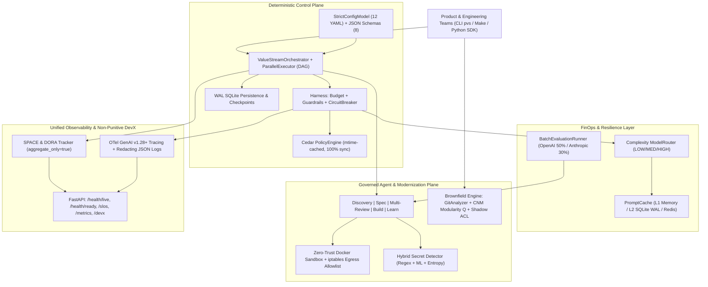

# AI-Native Product Value System — Architecture Guide

> **Canonical Specification**: See [`../ARCHITECTURE.md`](../ARCHITECTURE.md) for the original canonical architecture specification and [`architecture/DIAGRAMS.md`](architecture/DIAGRAMS.md) for detailed C4 (L1–L3), Sequence, Trust Boundary, Data Flow, and Deployment diagrams.

---

## Executive Architectural Thesis

Following **Anthropic's *"Building Effective Agents"***, **McKinsey's AI-Native Software Engineering Operating Model**, and **Gartner's AI Engineering Governance** principles, this system cleanly separates two planes:

1. **Deterministic Control Plane (Code-Driven)**: Enforces strict Pydantic v2 YAML config contracts (`config/*.yaml`), JSON Schema 2020-12 artifact contracts (`schemas/*.json`), mtime-cached Cedar authorization (`policies/`), hard USD/token budgets + `EMERGENCY_STOP`, AWS-style circuit breakers & full-jitter retries, WAL-tuned SQLite persistence, and DAG-based parallel orchestration.
2. **Probabilistic Agent Execution Plane (Bounded & Observable)**: Specialized agents (`Discovery`, `Specification`, `ArchitectureReview`, `SecurityReview`, `Build`, `Brownfield`, `Measurement`, `ExperimentDesign`) execute inside governed harnesses with FinOps routing/caching, zero-trust Docker egress filtering, hybrid ML secret scanning, and OpenTelemetry GenAI v1.28+ tracing.

---

## C4 System Architecture Overview (31 Packages)

---

## Subsystem Map & Technical Guides

| Architectural Plane | Packages | Primary Documentation & ADRs |
|---|---|---|
| **Orchestration & Parallelism** | `orchestrator`, `review`, `feature_flags`, `persistence` | [Parallel Execution](parallel-execution.md), [Multi-Agent Review](architecture/multi-agent-review.md), [ADR-0002](adr/ADR-0002-elephant-goldfish-multi-agent-review.md), [ADR-0003](adr/ADR-0003-progressive-delivery-and-feature-flags.md) |
| **FinOps & Resilience** | `caching`, `routing`, `evaluation`, `harness` | [Token Caching](token-caching.md), [Model Routing](model-routing.md), [Batch Evaluations](batch-evaluations.md), [ADR-0004](adr/ADR-0004-finops-caching-routing-and-batch-optimization.md) |
| **Security & Zero-Trust Governance** | `policy`, `security`, `sandbox`, `runtime`, `contracts` | [Threat Model](THREAT_MODEL.md), [Network Filtering](network-filtering.md), [Policy Sync](POLICY_SYNC.md), [ADR-0001](adr/ADR-0001-use-cedar-for-policy-engine.md), [ADR-0005](adr/ADR-0005-zero-trust-sandbox-egress-and-hybrid-secret-detection.md) |
| **Brownfield Modernization** | `brownfield`, `drift`, `adr`, `spec_kit` | [Git History Analysis](git-history-analysis.md), [Strangler Fig Modernization](strangler-fig-modernization.md), [ADR-0006](adr/ADR-0006-brownfield-modularity-and-non-punitive-devx-governance.md) |
| **Discovery, Evidence & Learning** | `simulation`, `discovery`, `evidence`, `experiments`, `validation`, `learning` | [Evidence Synthesis](evidence-synthesis.md), [Experiment Design](experiment-design.md), [Learning API](reference/api/learning.md) |
| **Observability & DevX** | `observability`, `monitoring`, `metrics`, `api`, `cli` | [OTel GenAI Conventions](otel-genai-conventions.md), [DevX Metrics](devx-metrics.md), [Empirical Benchmarks](BENCHMARKS.md) |

---

## Architecture Decision Records (ADRs)

All major architectural trade-offs are version-controlled in [`docs/adr/`](adr/README.md) following Michael Nygard's ADR standard:
- [ADR-0001: Use Cedar for Policy Engine](adr/ADR-0001-use-cedar-for-policy-engine.md)
- [ADR-0002: Elephant-Goldfish Multi-Agent Independent Review](adr/ADR-0002-elephant-goldfish-multi-agent-review.md)
- [ADR-0003: Consistent SHA-256 Feature Flags and Progressive Delivery](adr/ADR-0003-progressive-delivery-and-feature-flags.md)
- [ADR-0004: FinOps Caching, Model Routing, Batching, and Resilience Stack](adr/ADR-0004-finops-caching-routing-and-batch-optimization.md)
- [ADR-0005: Zero-Trust Sandbox Egress and Hybrid ML Secret Detection](adr/ADR-0005-zero-trust-sandbox-egress-and-hybrid-secret-detection.md)
- [ADR-0006: Brownfield Modularity Detection and Non-Punitive SPACE/DORA Governance](adr/ADR-0006-brownfield-modularity-and-non-punitive-devx-governance.md)
