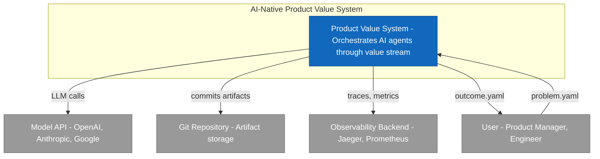
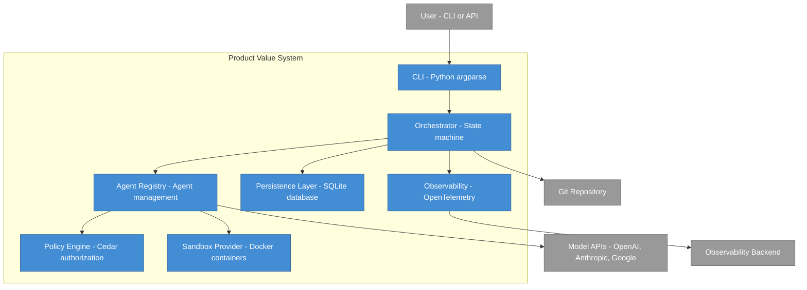
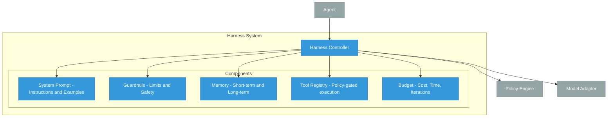
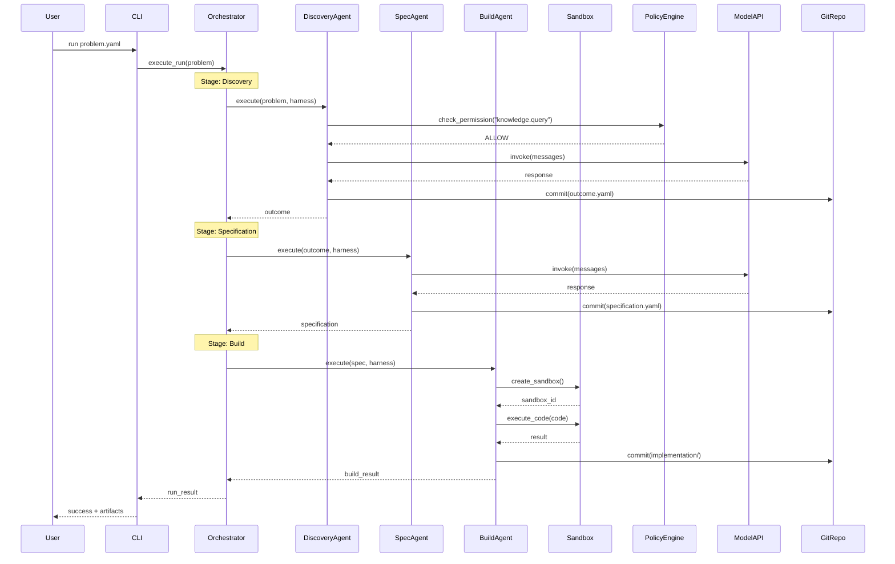
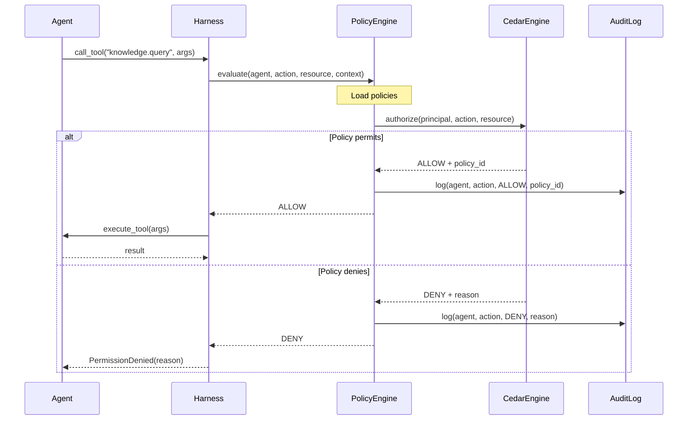
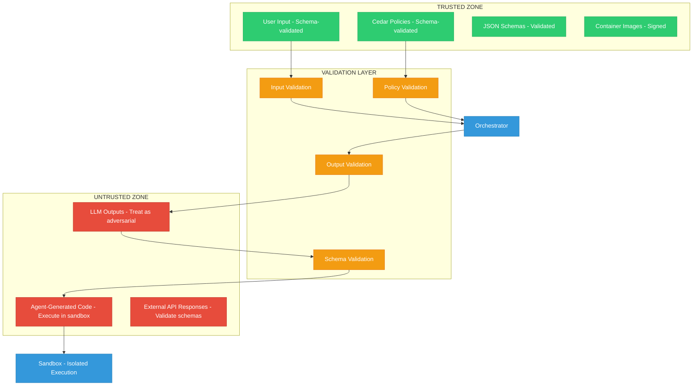
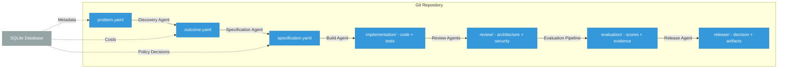
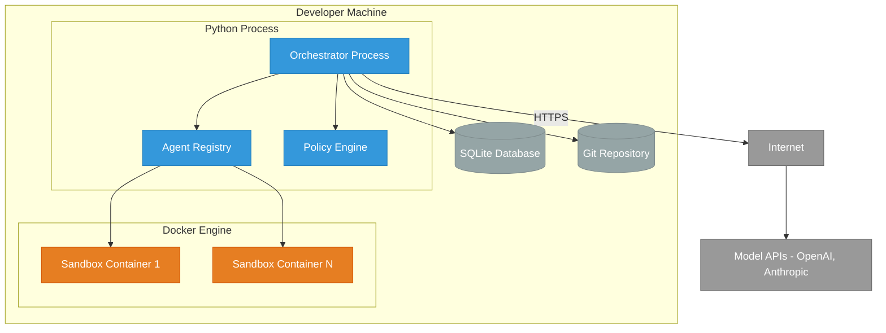

# Architecture Diagrams

This document contains all architecture diagrams for the AI-native Product Value System.

**Diagram Format**: Mermaid (text-based, renders natively in GitHub)

---

## 1. System Context (C4 Level 1)

**Source**: [01-system-context.mmd](diagrams/01-system-context.mmd)

**Alt Text:** System context diagram showing the Product Value System at the center, with interactions to User (input/output), Model APIs (LLM calls), Git Repository (artifact storage), and Observability Backend (telemetry).

---

## 2. Container Diagram (C4 Level 2)

**Source**: [02-container-diagram.mmd](diagrams/02-container-diagram.mmd)

**Alt Text:** Container diagram showing Product Value System internal containers: CLI, Orchestrator, Agent Registry, Policy Engine, Sandbox Provider, Persistence Layer, and Observability. External systems include User, Model APIs, Git Repository, and Observability Backend.

---

## 3. Component Diagram: Harness System (C4 Level 3)

**Source**: [03-component-diagram.mmd](diagrams/03-component-diagram.mmd)

**Alt Text:** Component diagram showing Harness System components: System Prompt, Guardrails, Memory, Tool Registry, and Budget. Harness Controller coordinates components and connects to Agent, Policy Engine, and Model Adapter.

---

## 4. Value Stream Run Sequence

**Source**: [04-value-stream-sequence.mmd](diagrams/04-value-stream-sequence.mmd)

**Alt Text:** Sequence diagram showing a complete value stream run: User submits problem via CLI, Orchestrator coordinates Discovery Agent (with policy check and model call), Specification Agent, and Build Agent (with sandbox execution), committing artifacts to Git at each stage.

---

## 5. Policy Evaluation Sequence

**Source**: [05-policy-evaluation-sequence.mmd](diagrams/05-policy-evaluation-sequence.mmd)

**Alt Text:** Sequence diagram showing policy evaluation flow: Agent requests tool call via Harness, Harness checks with Policy Engine, Policy Engine evaluates using Cedar Engine, result logged to Audit Log, and permission granted or denied to Agent with rationale.

---

## 6. Trust Boundaries

**Source**: [06-trust-boundaries.mmd](diagrams/06-trust-boundaries.mmd)

**Alt Text:** Trust boundary diagram showing three zones: Trusted Zone (user input, policies, schemas), Validation Layer (input/output/schema/policy validation), and Untrusted Zone (LLM outputs, agent-generated code, external APIs). Arrows show data flowing through validation layers before reaching orchestrator and sandbox.

---

## 7. Data Flow: Artifact Lifecycle

**Source**: [07-data-flow.mmd](diagrams/07-data-flow.mmd)

**Alt Text:** Data flow diagram showing artifact lifecycle from problem.yaml through outcome, specification, implementation, review, evaluation, to release decision. All artifacts stored in Git Repository. Database stores metadata, costs, and policy decisions alongside artifacts.

---

## 8. Deployment: MVP Single-Machine

**Source**: [08-deployment.mmd](diagrams/08-deployment.mmd)

**Alt Text:** Deployment diagram showing single-machine MVP architecture. Developer machine runs Python processes (Orchestrator, Agent Registry, Policy Engine), Docker Engine with multiple sandbox containers, SQLite database, and Git repository. Orchestrator connects to external Model APIs via HTTPS through internet.

---

**Last Updated**: 2026-11-18
