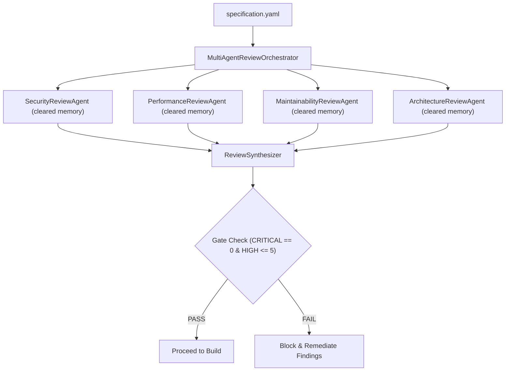

# Multi-Agent Review Architecture (Elephant-Goldfish Pattern)

## Design Rationale

Single-pass review inside the same conversation context suffers from confirmation bias. The **Elephant-Goldfish pattern** pairs:

- **Elephant (Orchestrator & Authoring Stages)**: Full lifecycle context across `Problem → Discovery → Specification`.
- **Goldfish (Independent Reviewers)**: Each review agent receives **only the specification artifact** inside a fresh `Harness` with `harness.memory.clear()` invoked before model execution—zero conversation history and zero cross-contamination between reviewers.

---

## Execution Flow

---

## Key Components

- [`src/product_value_system/review/models.py`](../../src/product_value_system/review/models.py) — `FindingSeverity`, `FindingCategory`, `ReviewFinding`, `ReviewConflict`, `ReviewResult`.
- [`src/product_value_system/review/synthesizer.py`](../../src/product_value_system/review/synthesizer.py) — Aggregation, prioritization, conflict detection/resolution, and release gate evaluation.
- [`src/product_value_system/review/orchestrator.py`](../../src/product_value_system/review/orchestrator.py) — Concurrent `asyncio.gather()` orchestration with per-reviewer isolated harnesses, budgets, and timeouts.
- [`src/product_value_system/agents/base_review_agent.py`](../../src/product_value_system/agents/base_review_agent.py) — Shared Goldfish isolation, JSON Schema validation, and flexible response parsing.

---

## Rollback & Opt-In Controls

In `ValueStreamOrchestrator`, multi-agent review is opt-in via `use_multi_agent_review=True` or `config={"enable_multi_review": True}` (CLI: `pvs run problem.yaml --multi-review`). Setting `enable_multi_review=False` immediately falls back to the standard sequential review stages with zero breaking changes.
