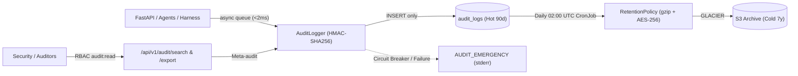

# SOC2 Trust Service Criteria — Compliance Control Mapping

This document maps the AI-Native Product Value System's immutable compliance audit trail (`product_value_system.compliance`) to the AICPA SOC2 Trust Service Criteria (CC6, CC7, CC8) and documents reproducible evidence collection and testing procedures.

---

## Architecture Overview

---

## CC6.1 — Logical and Physical Access Controls

### Control: Immutable Audit Logging of Access & Operations

- **Implementation**: `AuditLogger` (`src/product_value_system/compliance/audit_logger.py`) captures 22 structured `AuditEventType` categories:
  - Authentication & identity: `user.login`, `user.logout`, `user.login.failed`, `user.created`, `user.deleted`, `user.permission.changed`
  - Data handling: `data.read`, `data.write`, `data.delete`, `data.export`
  - AI model & agent execution: `model.called`, `model.response`, `agent.started`, `agent.completed`, `agent.failed`, `code.executed`
  - Secrets & configuration: `secret.accessed`, `secret.rotated`, `config.changed`, `audit.log.accessed`
  - GDPR Data Subject Rights: `gdpr.export.requested`, `gdpr.deletion.requested`
- **Cryptographic Integrity**: Every event is canonicalized (deterministic sorted JSON) and signed with RFC 2104 HMAC-SHA256 (`AuditSigner` in `src/product_value_system/compliance/signing.py`) using constant-time verification (`cryptography.hazmat.primitives.constant_time.bytes_eq`).
- **Immutability Enforcement**:
  - PostgreSQL (`migrations/postgres/002_create_audit_tables.sql` & `alembic/versions/001_create_audit_tables.py`): `GRANT SELECT, INSERT ON audit_logs TO pvs_user; REVOKE DELETE, UPDATE, TRUNCATE ON audit_logs FROM pvs_user;`.
  - SQLite WAL (`migrations/002_create_audit_tables.sql`): database-level `BEFORE UPDATE` and `BEFORE DELETE` triggers raising `ABORT`.
- **Sensitive Field Redaction**: Keys matching `password`, `secret`, `api_key`, `token`, `authorization`, `private_key`, `ssn`, and `credit_card` are recursively replaced with `[REDACTED]` prior to signing and storage.

**Evidence**:
- Schema migrations: [002_create_audit_tables.sql](../../migrations/postgres/002_create_audit_tables.sql), [001_create_audit_tables.py](../../alembic/versions/001_create_audit_tables.py)
- Test verification: `tests/compliance/test_audit_logger.py` (`test_audit_log_persists`, `test_signature_verification`, `test_audit_log_immutable`)

**Testing Procedure**:
1. Execute `pytest tests/compliance/test_audit_logger.py -v`.
2. In PostgreSQL, confirm `has_table_privilege('pvs_user', 'audit_logs', 'INSERT') = true` and `DELETE`/`UPDATE` = `false`.
3. Call `POST /api/v1/audit/verify` with an `audit:read` credential and confirm `integrity_verified: true`.

---

## CC6.2 & CC6.3 — User Access Provisioning & Quarterly Access Reviews

### Control: Automated Quarterly Access Review

- **Implementation**: `QuarterlyAccessReviewer` (`src/product_value_system/compliance/retention_policy.py`) inspects user and service-account entitlements against `AuditLogger` activity records:
  - Flags dormant accounts inactive for `>= 90 days` (`high` severity for privileged roles, `medium` for standard users).
  - Flags privileged human accounts (`admin`, `security_admin`, `compliance_officer`, or holders of `audit:read` / `compliance:admin` / `secrets:write`) lacking MFA (`high` severity).
  - Emits an auditable `AccessReviewReport` in JSON and Markdown formats and records a `config.changed` completion event in `audit_logs`.
- **Configuration**: Enabled via `compliance.soc2.quarterly_access_review: true` in [compliance.yaml](../../config/compliance.yaml).

**Evidence**:
- Automated quarterly review tests in `tests/compliance/test_audit_logger.py`
- Signed `AccessReviewReport` artifacts archived per quarter (`YYYY-Q1`..`YYYY-Q4`)

---

## CC7.2 — System Monitoring & Authorized Audit Investigation

### Control: RBAC-Protected Audit Search & Evidence Export API

- **Implementation**: `create_audit_router()` (`src/product_value_system/api/routes/audit.py`):
  - `GET /api/v1/audit/search`: Requires `audit:read` for global search, or `audit:self` for data subjects querying only their own events.
  - `GET /api/v1/audit/export`: Produces SOC2 auditor-ready CSV (with spreadsheet formula-injection neutralization) or JSON exports (`audit:read` required).
  - `POST /api/v1/audit/verify`: Runs HMAC-SHA256 signature verification sweeps to detect database tampering.
  - **Rate Limiting**: Per-principal sliding-window limiter defaulting to `100 requests/hour` (`429 Too Many Requests` with `Retry-After`).
  - **Meta-Audit Trail**: Every audit search and export automatically logs `audit.log.accessed`; unauthorized calls log `user.login.failed`.
  - **Resilience Fallback**: If database persistence fails or the circuit breaker opens, `AuditLogger` emits structured `AUDIT_EMERGENCY` JSON lines to `stderr` without crashing the application.

**Evidence**:
- API router: [audit.py](../../src/product_value_system/api/routes/audit.py)
- Configuration: [compliance.yaml](../../config/compliance.yaml)

---

## CC7.3 — Data Retention & Lifecycle Management

### Control: 90-Day Hot / 7-Year Cold Automated Archival

- **Implementation**: `RetentionPolicy` (`src/product_value_system/compliance/retention_policy.py`) scheduled by Kubernetes CronJobs ([cronjob-archive.yaml](../../deploy/helm/product-value-system/templates/cronjob-archive.yaml)):
  - **Hot Storage (90 days)**: PostgreSQL `audit_logs` table with 4 composite indexes for sub-second incident queries.
  - **Cold Storage (2,555 days / 7 years)**: Daily archival job (`0 2 * * *`) batches up to 1,000 logs per object, compresses with `gzip` level 9 (>80% storage reduction), and uploads to S3 `GLACIER` with `AES256` server-side encryption before pruning hot rows.
  - **End-of-Retention Deletion**: Monthly job (`0 3 1 * *`) deletes cold S3 objects older than 7 years and logs the summary event.

**Evidence**:
- Retention guide: [retention-policy.md](retention-policy.md)
- Archival & deletion tests: `tests/compliance/test_gdpr_compliance.py`

---

## CC8.1 — Change Management & Configuration Governance

### Control: Strict Schema Validation & Audited Configuration Changes

- **Implementation**:
  - `config/compliance.yaml` is validated at startup and in CI (`pvs doctor`) by `ComplianceConfigFile` (`extra="forbid"`, `frozen=True`).
  - Retention, archival, and access-review actions emit signed `config.changed` audit events.
  - All schema changes are versioned in `migrations/` and `alembic/versions/`.

---

## Related Documentation

- [GDPR Compliance Procedures](gdpr-compliance.md)
- [Audit Retention & Lifecycle Policy](retention-policy.md)
- [Vault Enterprise Secrets Integration](../security/vault-integration.md)
