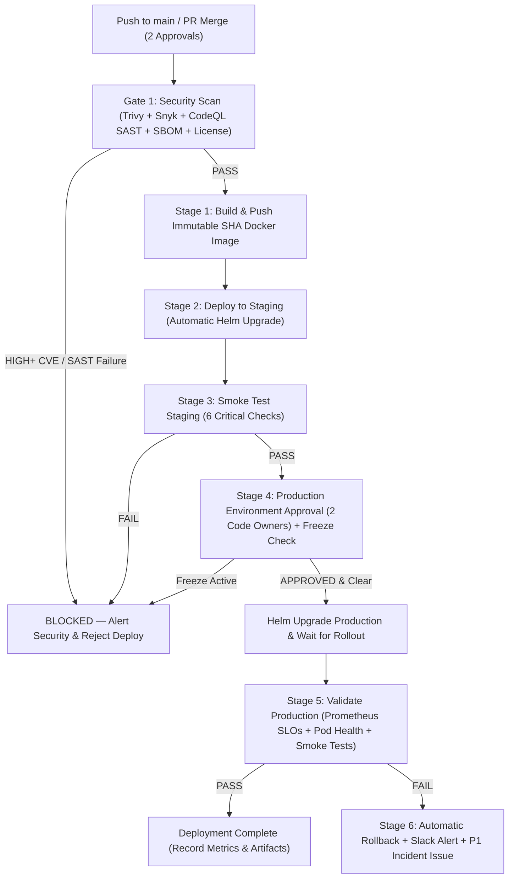

# Hardened CI/CD Deployment Process

**Owner**: Release Engineering & SRE Team  
**Last Updated**: 2026-11-23  
**Workflow**: [.github/workflows/deploy-hardened.yml](../../.github/workflows/deploy-hardened.yml)

---

## 1. Overview & Security Invariants

Every production release of the AI-Native Product Value System flows through a **6-stage hardened GitHub Actions pipeline** combining shift-left security scanning, automated staging verification, multi-reviewer production approval, deployment freeze enforcement, post-deploy SLO validation, and automatic rollback on failure.

### Core Invariants
1. **No Vulnerable Releases**: Trivy (app + sandbox images), Snyk / `pip-audit`, and CodeQL Python SAST block `HIGH`/`CRITICAL` CVEs before Docker image push.
2. **Defense-in-Depth Promotion**: Every release automatically deploys and passes 6 smoke checks in `staging` before `production` approval can execute.
3. **Dual Code Owner Approval**: Production deployments require `>= 2` Code Owner approvals via GitHub Protected Environments (`production`) and protected `main` branch rules.
4. **Automatic Self-Healing Rollback**: Failed production validation (`5xx >= 2%`, `p99 >= 2s`, unready pods, or failed smoke tests) automatically triggers [auto-rollback.sh](../../scripts/deployment/auto-rollback.sh), pages `#incidents`, and opens a `P1` GitHub incident issue.
5. **Complete Audit Trail**: Every deployment records commit SHA, actor, approving reviewers, freeze status, smoke test JSON artifacts, and rollback outcome.

---

## 2. Hardened Deployment Pipeline Architecture



---

## 3. Pipeline Stages & Automated Gates

| Stage | Workflow Job | Automation Script / Tool | Failure Behavior |
|---|---|---|---|
| **Gate 1** | `security-gate` | [security-scan.yml](../../.github/workflows/security-scan.yml) (Trivy, Snyk/`pip-audit`, CodeQL SAST, SBOM, License) | Hard fail on `HIGH`/`CRITICAL` CVEs or GPL/AGPL licenses |
| **Stage 1** | `build` | Docker Buildx (multi-stage non-root UID `10001`, SHA-tagged) | Halts promotion |
| **Stage 2** | `deploy-staging` | `helm upgrade --install --wait` (`staging` environment) | Halts promotion |
| **Stage 3** | `smoke-test-staging` | [smoke-tests.sh](../../scripts/deployment/smoke-tests.sh) (6 endpoint & latency checks) | Blocks production approval |
| **Stage 4** | `deploy-production` | GitHub `production` approval (`>= 2` reviewers) + [check-freeze.sh](../../scripts/deployment/check-freeze.sh) + Helm upgrade | Blocks if unapproved or inside freeze window |
| **Stage 5** | `validate-production` | [deployment-validation.sh](../../scripts/deployment/deployment-validation.sh) + [smoke-tests.sh](../../scripts/deployment/smoke-tests.sh) | Triggers Stage 6 automatic rollback |
| **Stage 6** | `rollback-production` | [auto-rollback.sh](../../scripts/deployment/auto-rollback.sh) + Slack alert + GitHub `P1` incident | Restores previous healthy Helm/K8s revision and verifies `/health/ready` |

---

## 4. Branch Protection & GitHub Environment Configuration

### 4.1 Apply `main` Branch Protection
Configuration is versioned in [.github/branch-protection.json](../../.github/branch-protection.json) alongside [.github/CODEOWNERS](../../.github/CODEOWNERS):

```bash
# Apply hardened protection rules to main branch
gh api --method PUT repos/:owner/:repo/branches/main/protection \
  --input .github/branch-protection.json

# Verify active protection rules
gh api repos/:owner/:repo/branches/main/protection \
  | jq '{approvals: .required_pull_request_reviews.required_approving_review_count, enforce_admins: .enforce_admins.enabled, allow_force_pushes: .allow_force_pushes.enabled, checks: .required_status_checks.contexts}'
```

Key protections enforced:
- `required_approving_review_count: 2` with `require_code_owner_reviews: true` and `dismiss_stale_reviews: true`
- `strict: true` status checks requiring `Security Scanning` (Trivy, Snyk, CodeQL SAST) and `CI` (lint, security-and-governance, test)
- `enforce_admins: true`, `allow_force_pushes: false`, `allow_deletions: false`, `required_conversation_resolution: true`

### 4.2 Configure GitHub Environments (`staging` & `production`)
1. **`staging`**: No manual approval required; scoped secrets `KUBECONFIG_STAGING`, `STAGING_URL`, `STAGING_API_TOKEN`.
2. **`production`**:
   - Enable **Required reviewers** (`>= 2` Code Owners / SRE Leads).
   - Restrict deployment branches to `main` only.
   - Scoped secrets: `KUBECONFIG_PRODUCTION`, `PRODUCTION_URL`, `PRODUCTION_API_TOKEN`, `PROMETHEUS_URL`, `SLACK_WEBHOOK_URL`.

---

## 5. Emergency P0 Hotfix Path

When a `P0` outage or active security breach occurs during a deployment freeze:
1. Declare a `P0` incident per [Incident Management Process](incident-management.md) and obtain IC + Engineering Lead sign-off in `#incidents`.
2. Open a minimal hotfix PR against `main` (all security scans and unit tests still execute).
3. Trigger `Deploy (Hardened)` via **Actions -> Run workflow (`workflow_dispatch`)** with:
   - `environment: production`
   - `emergency_hotfix: true`
   - `hotfix_reason: "INC-YYYYMMDD-HHMM: <brief P0 justification>"`
4. Complete dual reviewer approval in the `production` environment gate. The override reason is logged verbatim in GitHub Actions for SOC2 auditability.

---

## 6. Deployment Metrics & Recovery

- **Dashboard**: Import [grafana/dashboards/deployment-metrics.json](../../grafana/dashboards/deployment-metrics.json) (`uid: pvs-deployment-metrics`) to track:
  - Deployment success rate (target `> 98%`)
  - End-to-end deployment duration (target `< 20 min`)
  - Rollback recovery duration (target `< 3 min`)
  - Automatic rollback count & security gate blocks
- **Manual Recovery**: If automatic rollback reports unready pods, immediately execute [Rollback Procedure](../runbooks/rollback-procedure.md) and open a P1 incident via [create-incident.sh](../../scripts/incident-management/create-incident.sh).

---

## Related Documentation

- [Deployment Freeze Calendar](deployment-freeze-calendar.md)
- [Production Deployment Checklist](../runbooks/deployment-checklist.md)
- [Emergency Rollback Procedure](../runbooks/rollback-procedure.md)
- [Vulnerability Management Policy](../security/vulnerability-management.md)
- [Incident Management Process](incident-management.md)
- [CI/CD Deployment Metrics Dashboard](../../grafana/dashboards/deployment-metrics.json)
