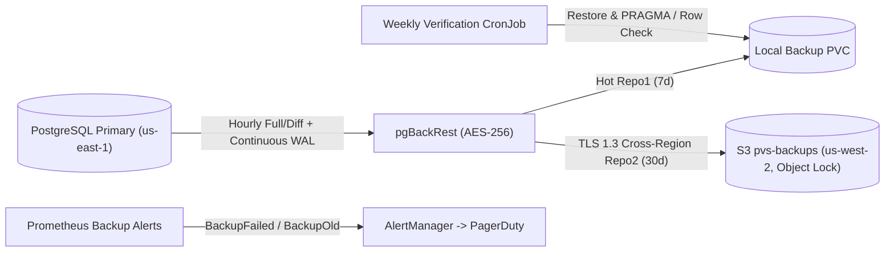

# Disaster Recovery Plan & Business Continuity Procedures

This plan establishes automated backups, Point-in-Time Recovery (PITR), cross-region S3 replication, ransomware immutability, and quarterly DR drills for the AI-Native Product Value System.

---

## Recovery Objectives (SLAs)

- **RTO (Recovery Time Objective)**: **`< 1 hour`** (`3,600s`)
- **RPO (Recovery Point Objective)**: **`< 15 minutes`** (`900s`, enforced by PostgreSQL `archive_timeout = 300s` continuous WAL archiving)

---

## Backup & Replication Architecture

- **pgBackRest Config**: [deploy/postgres/pgbackrest.conf](../../deploy/postgres/pgbackrest.conf)
- **PostgreSQL WAL Config**: [deploy/postgres/postgresql-wal.conf](../../deploy/postgres/postgresql-wal.conf)
- **Helm CronJobs**: [backup-cronjob.yaml](../../deploy/helm/product-value-system/templates/backup-cronjob.yaml) (`0 * * * *`), [backup-verification-cronjob.yaml](../../deploy/helm/product-value-system/templates/backup-verification-cronjob.yaml) (`0 6 * * 0`)
- **Python DR Engine**: [disaster_recovery.py](../../src/product_value_system/persistence/disaster_recovery.py) (`AES-256-GCM`, SHA-256 checksums, automated DR drill telemetry)

### Retention & Encryption Tiers

| Tier | Repository | Retention | Encryption | Purpose |
|---|---|---|---|---|
| **Hot Local** | `repo1` (`/var/lib/pgbackrest`) | 7 full / 4 diff / 7d WAL | AES-256 (key in Vault / Secret) | Sub-15m fast local restore |
| **Cross-Region Warm** | `repo2` (`s3://pvs-backups`, `us-west-2`) | 30 days full + WAL | AES-256 + TLS 1.3 + S3 Object Lock (`COMPLIANCE`) | Region outage & ransomware protection |
| **Compliance Cold** | `s3://pvs-audit-archive` (`GLACIER`) | 7 years (`2,555d`) | `AES256` + `gzip` level 9 | SOC2 / GDPR / HIPAA audit logs |

---

## Recovery Scenarios

### Scenario 1 — Database Corruption / Accidental `DROP TABLE` (`RTO <= 30 min`)
1. Freeze application writes: `kubectl scale deployment product-value-system --replicas=0 -n product-value-system`.
2. Identify the exact UTC timestamp immediately preceding corruption from `audit_logs` / application logs.
3. Execute PITR: `./scripts/pitr-recovery.sh "YYYY-MM-DD HH:MM:SS"`.
4. Verify `audit_logs` HMAC signatures via `POST /api/v1/audit/verify` and run `make test-integration`.
5. Restore application replicas (`replicas=3`).

### Scenario 2 — Complete Primary Region Outage (`us-east-1 -> us-west-2`, `RTO <= 1 hour`)
1. Declare P0 incident in PagerDuty and assemble DR leads (Incident Commander, DB Lead, Comms).
2. Deploy control-plane chart to standby `us-west-2` cluster.
3. Restore database from cross-region S3 `repo2`: `./scripts/restore-database.sh --repo 2 --target latest`.
4. Shift DNS / load-balancer weights to `us-west-2`, run smoke checks (`/health/ready`, `/slos`), and update status page.

### Scenario 3 — Ransomware Attack (`RTO <= 2 hours`)
1. Isolate compromised workloads via zero-trust `NetworkPolicy` and revoke all credentials per [Emergency Secret Revocation Runbook](runbooks/emergency-secret-revocation.md).
2. Restore from immutable S3 Object Lock `COMPLIANCE` backup predating initial compromise: `./scripts/restore-database.sh --repo 2 --target <clean-backup-id>`.
3. Verify zero tampering via `AuditLogger.verify_events()` and file a security postmortem.

---

## Quarterly DR Drills

- **Schedule**: **Q1** (Jan 15), **Q2** (Apr 15), **Q3** (Jul 15), **Q4** (Oct 15).
- **Success Criteria**:
  - Restored database passes integrity checks with `0` rows lost.
  - Measured `RTO < 1 hour` and `RPO < 15 minutes`.
  - Drill report (`DRDrillReport`) archived as SOC2 compliance evidence in `audit_logs`.

---

## Backup Health Monitoring & Alerts

Defined in [prometheusrule.yaml](../../deploy/helm/product-value-system/templates/prometheusrule.yaml) (`backup_health` group):
- **`BackupFailed`** (`critical` -> PagerDuty): Backup or weekly verification job failed.
- **`BackupOld`** (`warning` -> Slack): Last successful backup age exceeds `2 hours` (`7,200s`).
- **`BackupSizeTooSmall`** (`warning` -> Slack): Backup size dropped below `50%` of 7-day rolling median (potential truncation/corruption).

---

## Related Documentation

- [Restore Procedures Quick Reference](restore-procedures.md)
- [On-Call Handbook](oncall-guide.md)
- [Audit Retention Policy](../compliance/retention-policy.md)
