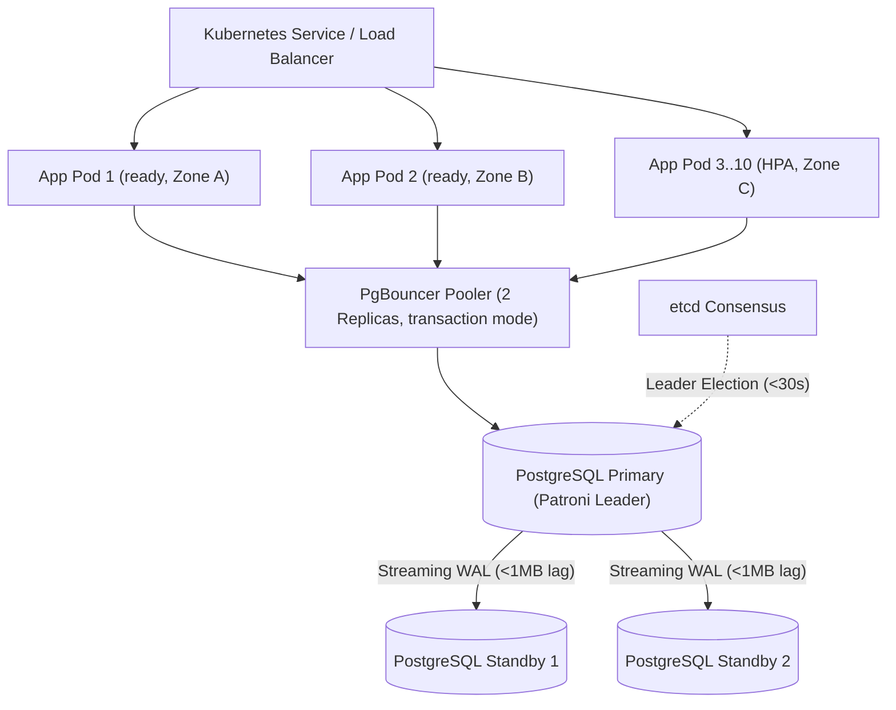

# High Availability (HA) Architecture

The AI-Native Product Value System achieves **99.9%+ availability** (`<= 43.2 min/month` downtime budget) through multi-layer redundancy, auto-scaling, zero-downtime rolling deployments, PgBouncer transaction pooling, and Patroni-managed PostgreSQL streaming replication.

---

## Multi-Layer Redundancy Topology



---

## Component Configuration

| Layer | Manifest | HA Setting |
|---|---|---|
| **Application Pods** | [deployment.yaml](../../deploy/helm/product-value-system/templates/deployment.yaml) | `replicas: 3`, `maxSurge: 1`, `maxUnavailable: 0`, `terminationGracePeriodSeconds: 60`, `preStop: sleep 15`, node & zone `podAntiAffinity` |
| **Auto-Scaling** | [hpa.yaml](../../deploy/helm/product-value-system/templates/hpa.yaml) | `minReplicas: 3`, `maxReplicas: 10`, CPU `70%`, Memory `80%`, optional `http_requests_per_second`, asymmetric `scaleUp` (60s) / `scaleDown` (300s) |
| **Disruption Safety** | [pdb.yaml](../../deploy/helm/product-value-system/templates/pdb.yaml) | `minAvailable: 2`, `unhealthyPodEvictionPolicy: IfHealthyBudget` |
| **Health Probes** | [health.py](../../src/product_value_system/api/health.py) | `/health/live`, `/health/ready`, `/health/startup`, `/health/metrics-summary` (`X-Pod-Name`) |
| **Connection Pooling** | [pgbouncer.yaml](../../deploy/helm/product-value-system/templates/pgbouncer.yaml) & [postgres.py](../../src/product_value_system/persistence/postgres.py) | `2` replicas, `pool_mode = transaction`, `max_client_conn = 1000`, `default_pool_size = 20`, `statement_cache_size = 0` (`asyncpg` transaction-pool safe) |
| **PostgreSQL HA** | [postgresql-ha.yaml](../../deploy/helm/product-value-system/templates/postgresql-ha.yaml) | `3` replicas (`1` primary + `2` streaming standbys), Patroni + `etcd3`, `use_pg_rewind: true`, `maximum_lag_on_failover: 1MB`, TLS `scram-sha-256` |

---

## Failure Scenarios & Recovery Targets

| Failure Scenario | Detection | Automated Response | Target RTO | Target RPO |
|---|---|---|---|---|
| **Single Pod Crash** | Liveness probe (`3 x 10s`) | Kubelet restarts pod; `2+` peers serve traffic | `30–60s` | `0` (stateless) |
| **Node Failure / Drain** | Node NotReady / PDB | PDB enforces `minAvailable: 2`; reschedules cleanly | `60–120s` | `0` |
| **DB Primary Crash** | Patroni leader TTL (`10s`) | Patroni promotes streaming standby with `< 1MB` lag | **`< 30s`** | `< 1MB` WAL |
| **AZ Outage** | Cross-zone anti-affinity | Remaining AZs absorb traffic; HPA scales out | `2–5 min` | `< 1MB` WAL |

---

## Single-Replica Mode for Local Dev / Cost Savings

Dev and staging environments can override HA defaults cleanly:
```bash
helm upgrade --install pvs deploy/helm/product-value-system \
  --set replicaCount=1 --set autoscaling.enabled=false \
  --set podDisruptionBudget.enabled=false \
  --set postgresql.ha.enabled=false --set pgbouncer.enabled=false
```

---

## Related Documentation

- [Failover & Zero-Downtime Procedures](failover-procedures.md)
- [Disaster Recovery Plan](disaster-recovery-plan.md)
- [Production SLOs & Alerting Rules](slos.md)
