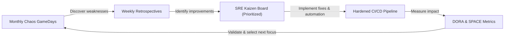

# Continuous Improvement Metrics Framework (DORA & SPACE)

**Owner**: SRE & Engineering Leadership  
**Dashboard**: [grafana/dashboards/improvement-metrics.json](../../grafana/dashboards/improvement-metrics.json) (`uid: pvs-improvement-metrics`)  
**Last Updated**: 2026-11-23

---

## 1. Improvement Flywheel

Continuous improvement links proactive failure discovery, blameless learning, prioritized Kaizen execution, hardened CI/CD delivery, and objective telemetry:

---

## 2. DORA Delivery & Reliability Metrics

We track all four **DevOps Research and Assessment (DORA)** metrics openly in [improvement-metrics.json](../../grafana/dashboards/improvement-metrics.json) and review trends every Friday at 15:00:

| DORA Metric | Prometheus Expression | Elite | High | Medium | Low |
|---|---|---|---|---|---|
| **Deployment Frequency** | `sum(increase(deployments_total{environment="production"}[7d])) / 7` | Multiple / day | Weekly – Monthly | Monthly – 6 mo | `< 1 / 6 mo` |
| **Lead Time for Changes** | `histogram_quantile(0.5, sum(rate(deployment_lead_time_seconds_bucket[7d])) by (le)) / 3600` | `< 1 hour` | `< 1 day` | `< 1 week` | `> 1 month` |
| **Change Failure Rate** | `(sum(increase(deployments_total{result="failed"}[30d])) / clamp_min(sum(increase(deployments_total[30d])), 1e-9)) * 100` | `0–15%` | `16–30%` | `31–45%` | `> 45%` |
| **Mean Time To Recovery (MTTR)** | `histogram_quantile(0.5, sum(rate(incident_duration_seconds_bucket{severity=~"P0|P1"}[30d])) by (le)) / 60` | `< 1 hour` | `< 1 day` | `< 1 week` | `> 1 month` |

---

## 3. Non-Punitive SPACE Developer Experience Metrics

Delivery speed without team sustainability leads to burnout and regressions. Our existing `DevXTracker` and `SPACECalculator` (`src/product_value_system/metrics/`, documented in [DevX Metrics](../devx-metrics.md)) enforce **`aggregate_only: true`** and **`anonymize: true`** across all five SPACE dimensions:

| SPACE Dimension | Primary Aggregate Signal | Target / Guardrail |
|---|---|---|
| **Satisfaction & Well-being** | Quarterly anonymous team satisfaction survey & on-call fatigue score | `> 4.0 / 5.0` satisfaction; `< 5 pages/week` |
| **Performance** | SLO achievement (`99.9%` availability), GameDay pass rate, customer value outcomes | GameDay pass rate `> 85%`; SLOs met |
| **Activity** | Aggregate PR throughput, automated test pass rate, Kaizen item closure rate | Never evaluated per-individual |
| **Communication & Collaboration** | PR review turnaround time, IC rotation participation, postmortem completion rate | `>= 95%` P0/P1 postmortem completion |
| **Efficiency & Flow** | Monthly operational toil percentage, CI build duration, uninterrupted focus blocks | **Toil `< 30%`**; learning time `>= 20%` |

---

## 4. Operational Resilience & Kaizen KPIs

| KPI | Calculation | Target | Review Cadence |
|---|---|---|---|
| **GameDay Success Rate** | `sum(gameday_success_total) / clamp_min(sum(gameday_total), 1e-9) * 100` | `>= 85%` | Monthly |
| **Monthly Toil Ratio** | `(Manual repetitive hours / Total engineering hours) * 100` | `< 30%` | Monthly |
| **Postmortem Action Closure** | `% of P0/P1 postmortem tickets closed within SLA on Kaizen Board` | `>= 95%` | Weekly |
| **DR Drill SLA Compliance** | Quarterly RTO `< 60m` & RPO `< 15m` verified | `100%` (4/4 quarters) | Quarterly |

---

## 5. Anti-Gaming & Transparency Principles

- **Never weaponize metrics**: DORA and SPACE metrics are **team-level diagnostic instruments**, never individual performance rankings or punitive quotas.
- **Measure pairs, not single numbers**: Always evaluate speed (`Deployment Frequency`, `Lead Time`) alongside stability (`Change Failure Rate`, `MTTR`) and sustainability (`Toil %`, `Team Satisfaction`).
- **Share openly**: Publish weekly DORA snapshots in `#metrics` and quarterly trends at engineering all-hands — including regressions so the team can remove systemic bottlenecks together.

---

## Related Documentation

- [DORA & Improvement Metrics Dashboard](../../grafana/dashboards/improvement-metrics.json)
- [DevX SPACE & DORA Telemetry](../devx-metrics.md)
- [CI/CD Deployment Metrics Dashboard](../../grafana/dashboards/deployment-metrics.json)
- [Incident Metrics Dashboard](../../grafana/dashboards/incident-metrics.json)
- [SRE Team Rituals](team-rituals.md)
- [SRE Kaizen Board](../../.github/projects/kaizen-board.yml)
