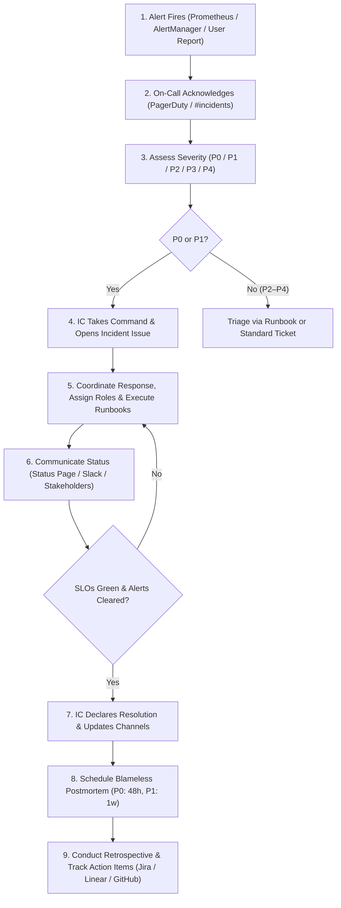

# Incident Management Process

**Owner**: SRE & Engineering Leadership  
**Last Updated**: 2026-11-23  
**Scope**: All production and staging incidents affecting the AI-Native Product Value System

---

## 1. Purpose & Core Principles

This document defines the formal end-to-end incident management process for the AI-Native Product Value System. It transforms unstructured alert responses into a repeatable, calm, and high-learning operational workflow that lowers Mean Time To Resolution (MTTR) and prevents recurring outages.

### Five Non-Negotiable Invariants
1. **Blameless Culture**: Postmortems investigate system, tooling, process, and observability gaps — never individual fault.
2. **Response Speed First**: Severity classification guides coordination and escalation but must never delay immediate mitigation.
3. **Clear Single Ownership**: Every P0/P1 (and escalated P2) incident has exactly **one** designated Incident Commander (IC).
4. **Mandatory Organizational Learning**: 100% of P0 and P1 incidents receive a published blameless postmortem with tracked preventive action items.
5. **Proportional Transparency**: Stakeholders and customers receive timely, accurate updates matched to business impact, without leaking secrets or PII.

---

## 2. End-to-End Incident Response Workflow



### Lifecycle Stages

| Stage | Objective | Primary Owner | Key Artifact / Tool |
|---|---|---|---|
| **1. Detect & Acknowledge** | Stop escalation clock and confirm active investigation | On-Call Engineer / IC | PagerDuty, `#incidents` |
| **2. Classify Severity** | Assign P0–P4 based on business impact | Incident Commander | [Incident Severity Guide](incident-severity-guide.md) |
| **3. Command & Triage** | Open tracking issue, assign diagnostic & comms roles, follow runbook | Incident Commander | [Incident Commander Guide](incident-commander-guide.md), [On-Call Quick Reference](../runbooks/oncall-quick-reference.md) |
| **4. Mitigate & Verify** | Restore SLOs first (rollback, scale, failover) before deep root-cause debugging | Responders + IC | [Troubleshooting Flowchart](../runbooks/troubleshooting-flowchart.md), [Rollback Procedure](../runbooks/rollback-procedure.md) |
| **5. Communicate** | Keep internal teams, leadership, and status page updated on cadence | IC / Comms Lead | [Communication Templates](communication-templates.md) |
| **6. Resolve** | Confirm all SLO dashboards green for `>= 10 min`, close alerts, thank team | Incident Commander | Grafana SLO & Alert Dashboards |
| **7. Learn & Prevent** | Write blameless postmortem, hold debrief, track P0/P1 action items to closure | Postmortem Author + Tech Lead | [Postmortem Template](postmortem-template.md) |

---

## 3. Severity Summary & Escalation Matrix

Full definitions, examples, and alert mappings are maintained in [Incident Severity Guide](incident-severity-guide.md).

| Severity | Business Impact | Ack SLA | Target MTTR | IC Required | Status Page | Escalation Trigger | Postmortem SLA |
|---|---|---|---|---|---|---|---|
| **P0** | Complete outage / active security breach | `<= 5 min` | `< 15 min` | Dual IC (Senior IC + Team Lead) | `<= 10 min`, then q15m | `15 min` -> VP Engineering | Mandatory (`<= 48h`) |
| **P1** | Major degradation / partial outage | `<= 15 min` | `< 1 hour` | Single On-Call IC | `<= 30 min` if ongoing | `1 hour` -> Team Lead | Mandatory (`<= 1 week`) |
| **P2** | Localized degradation / single pod | `<= 30 min` | `< 4 hours` | Optional (On-Call) | Internal only | `4 hours` -> Team Lead | Optional (recommended if novel) |
| **P3** | Early warning / zero user impact | `<= 2 hours` (biz) | `< 1 biz day` | No (ticket queue) | None | `2 biz days` -> Team Lead | Not required |
| **P4** | Informational / operational signal | Best effort | N/A | No | None | N/A | Not required |

### Escalation Contact Matrix

| Tier | Role | Trigger | Channel / Schedule |
|---|---|---|---|
| **Level 1** | Primary On-Call Engineer | Immediate (`0 min`) on `critical` page | `Product Value System - Primary On-Call` ([pagerduty-schedule.yaml](../../config/pagerduty-schedule.yaml)) |
| **Level 2** | Incident Commander (IC) / Backup On-Call | Auto-escalate at `15 min` or immediately for P0/P1 | `Product Value System - Incident Commander (IC)` & `Backup On-Call` |
| **Level 3** | Engineering Manager / Team Lead | Auto-escalate at `30 min` or P1 unresolved `> 1h` | PagerDuty Level 3 (`engineering-manager@example.com`) |
| **Level 4** | VP of Engineering | P0 unresolved `> 15 min` or customer-wide outage | Executive Incident Bridge / PagerDuty Executive Policy |
| **Specialist** | Security On-Call & DPO / Legal | Any suspected breach, secret leak, or audit tamper | [Emergency Security Breach](../runbooks/emergency-security-breach.md), [GDPR Compliance](../compliance/gdpr-compliance.md) |
| **Specialist** | Database Lead | Unrecoverable primary failure or data corruption | [Emergency Data Loss](../runbooks/emergency-data-loss.md), [Disaster Recovery Plan](disaster-recovery-plan.md) |

---

## 4. Automation & Tooling

All incident management scripts enforce `set -euo pipefail`, strict severity validation (`P0`–`P4`), `--dry-run` previews, and environment-variable secret injection (zero hardcoded tokens):

1. **Create Incident Tracking Issue**:
   ```bash
   ./scripts/incident-management/create-incident.sh "High API p99 Latency" "P1" "p99 > 5s across us-east-1" --dry-run
   ```
   Script: [create-incident.sh](../../scripts/incident-management/create-incident.sh) · Template: [.github/ISSUE_TEMPLATE/incident-report.md](../../.github/ISSUE_TEMPLATE/incident-report.md)
2. **Update Status Page**:
   ```bash
   ./scripts/incident-management/update-status-page.sh --incident-id INC-20261123-0200 --severity P1 --status investigating --title "API Latency Degradation" --message "Investigating elevated API latency." --dry-run
   ```
   Script: [update-status-page.sh](../../scripts/incident-management/update-status-page.sh)
3. **Notify Stakeholders (Slack / Webhook)**:
   ```bash
   ./scripts/incident-management/notify-stakeholders.sh --incident-id INC-20261123-0200 --severity P1 --status investigating --ic "alice" --title "API Latency Degradation" --summary "Scaling PgBouncer pool" --dry-run
   ```
   Script: [notify-stakeholders.sh](../../scripts/incident-management/notify-stakeholders.sh)
4. **Track Incident Metrics**:
   Import [grafana/dashboards/incident-metrics.json](../../grafana/dashboards/incident-metrics.json) (`uid: pvs-incident-metrics`) to monitor incidents by severity, MTTR p50 vs SLA targets, frequency trend, top categories, postmortem completion rate (`>= 95%` target), and 30-day MTTR improvement.

---

## 5. Follow-Up Action Item Governance (Jira / Linear / GitHub)

Postmortems only improve reliability when preventive actions ship on time:
- Every action item in a postmortem MUST have a **Priority (`P0`–`P3`)**, single **Owner**, **Due Date**, **Verification Criterion**, and linked **Issue ID** (GitHub Issue, Jira ticket, or Linear issue tagged `postmortem-action` and `incident:<INC-ID>`).
- **Completion SLAs**:
  - `P0` (Prevent immediate recurrence): **Due within 48 hours** (blocks feature work if overdue).
  - `P1` (Improve detection / resilience): **Due within 2 weeks** (scheduled into current/next sprint).
  - `P2` (Runbook / load test / tooling): **Due within 30 days**.
  - `P3` (Documentation / capacity process): **Due within 1 quarter**.
- **Weekly & Monthly Review**: Engineering Leads review open `postmortem-action` tickets in weekly triage; SRE Lead publishes monthly incident metrics (MTTR trend, frequency by category, postmortem completion rate) at engineering all-hands.

---

## 6. Incident Retrospective Meeting Format

Hold P0 retrospectives within **48 hours** and P1 retrospectives within **5 business days** (30–60 minutes, facilitated by IC or neutral SRE):

| Time | Agenda Block | Output |
|---|---|---|
| `00–05 min` | **Blameless Ground Rules & Impact Recap** — Reaffirm system-focused inquiry; summarize customer/SLO impact | Shared context |
| `05–20 min` | **Timeline Walkthrough** — Step through UTC events; surface surprises, delays, and alert/runbook gaps | Corrected timeline |
| `20–35 min` | **Contributing Factors & 5 Whys** — Identify technical, monitoring, capacity, and process root causes | Verified root causes |
| `35–50 min` | **Action Items & Owners** — Assign concrete preventive/detection fixes with due dates and verification | Tracked Jira/Linear/GitHub tickets |
| `50–60 min` | **Publish & Share** — Confirm redaction check, publish postmortem to private ops repo, announce key lessons | Completed postmortem |

---

## 7. Incident Documentation Checklist

Before closing any P0 or P1 incident record, verify:
- [ ] Incident issue created using [.github/ISSUE_TEMPLATE/incident-report.md](../../.github/ISSUE_TEMPLATE/incident-report.md) with accurate final severity (`P0`–`P4`)
- [ ] Complete UTC timeline recorded (detection, acknowledgement, diagnosis, mitigation, verification, resolution)
- [ ] Status page and stakeholder resolution updates sent (if P0/P1)
- [ ] All raw secrets, credentials, PII, and customer prompts redacted from logs, screenshots, and postmortem text
- [ ] Blameless postmortem drafted from [postmortem-template.md](postmortem-template.md) and reviewed by Team Lead (+ VP Engineering for P0/P1)
- [ ] All follow-up action items created in Jira/Linear/GitHub with owners and due dates
- [ ] Linked runbook(s) in `docs/runbooks/` updated with newly discovered diagnostic steps or pitfalls

---

## 8. Security, Confidentiality & Audit Boundaries

- **Access Control**: Incident issues and postmortems may reference internal architecture, vulnerabilities, or customer impact; store detailed postmortems in a **private** repository with RBAC restricted to engineering, security, and leadership.
- **No Raw Secrets or PII**: Never paste API keys, database passwords, session tokens, customer emails, or raw prompt bodies into Slack, GitHub issues, or status pages (`sanitize_incident_text()` in `product_value_system.monitoring.incident_manager` enforces automated redaction).
- **Immutable Audit Trail**: Security-related incidents (P0 breach or audit integrity alert) also generate signed compliance audit events per [SOC2 Controls](../compliance/soc2-controls.md).

---

## 9. Adoption Rollout & GameDay Exercises

1. **Phase 1 (Process & Tooling)**: Publish incident guides, templates, alert severity labels, Grafana dashboard, and automation scripts.
2. **Phase 2 (Enablement)**: Deliver 1-hour hands-on workshop to all on-call engineers covering P0–P4 classification, IC handoffs, and blameless 5 Whys.
3. **Phase 3 (GameDay Simulation)**: Run a quarterly live staging GameDay (e.g., terminating `postgresql-ha-0` during business hours with team awareness) to drill IC command, timeline capture, status updates, and postmortem drafting.
4. **Phase 4 (Pilot & Retrospective)**: Run 1-week pilot IC rotations for 30 days, then hold a process retrospective to tune alert-to-severity mappings and templates.
5. **Phase 5 (Full Operations)**: Track monthly MTTR, incident frequency, and `>= 95%` postmortem completion rate in Grafana.

---

## Related Documentation

- [Incident Severity Classification Guide (P0–P4)](incident-severity-guide.md)
- [Incident Commander (IC) Guide](incident-commander-guide.md)
- [Blameless Postmortem Template](postmortem-template.md)
- [Incident Communication Templates](communication-templates.md)
- [On-Call Handbook](oncall-guide.md)
- [Alert Runbook Index](alert-runbook-index.md)
- [On-Call Quick Reference (All 20 Runbooks)](../runbooks/oncall-quick-reference.md)
- [Incident Metrics Grafana Dashboard](../../grafana/dashboards/incident-metrics.json)
