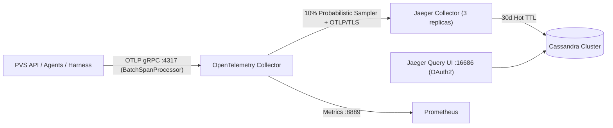

# Distributed Tracing with Jaeger — Operational Guide

This guide describes how distributed tracing works across the AI-Native Product Value System (`API -> Orchestrator -> Agents -> Harness -> Model APIs & Tools`), how traces are sampled and sanitized, and how to query Jaeger UI for latency, error, and cost analysis.

---

## Architecture



- **SDK Integration**: [tracing.py](../../src/product_value_system/observability/tracing.py), [trace_config.py](../../src/product_value_system/observability/trace_config.py), [trace_decorator.py](../../src/product_value_system/observability/trace_decorator.py)
- **Kubernetes Manifests**: [jaeger-values.yaml](../../deploy/helm/dependencies/jaeger-values.yaml), [otel-collector-config.yaml](../../deploy/otel-collector-config.yaml), [jaeger.yaml](../../deploy/helm/product-value-system/templates/jaeger.yaml)

---

## Accessing Jaeger UI

- **Production** (OAuth2/OIDC protected): `https://jaeger.product-value-system.internal`
- **Kubernetes Port-Forward**:
  ```bash
  kubectl port-forward -n jaeger svc/product-value-system-jaeger-query 16686:16686
  # Open http://localhost:16686
  ```
- **Local Development (Jaeger All-in-One)**:
  ```bash
  docker run --rm -d --name jaeger \
    -p 16686:16686 -p 4317:4317 -p 4318:4318 \
    jaegertracing/all-in-one:1.51
  export ENVIRONMENT=development
  export OTEL_EXPORTER_OTLP_ENDPOINT=http://localhost:4317
  export OTEL_EXPORTER_OTLP_INSECURE=true
  ```

---

## Sampling, Privacy & Cost Attribution

| Control | Production Default | Development Default | Environment Override |
|---|---|---|---|
| **Sampling Rate** | `10%` (`0.10`) | `100%` (`1.0`) | `OTEL_TRACES_SAMPLER_ARG` |
| **OTLP Transport** | TLS (`insecure=false`) | Plaintext (`insecure=true`) | `OTEL_EXPORTER_OTLP_INSECURE` |
| **Kill Switch** | Enabled | Enabled | `OTEL_SDK_DISABLED=true` |
| **Retention** | 30 days hot (Cassandra) / 90 days cold | In-memory | `jaeger-values.yaml` |
| **Sensitive Redaction** | Enabled (`SanitizingSpanProcessor` + `_redact_sensitive`) | Enabled | `OTEL_REDACT_SENSITIVE` |
| **GDPR User Pseudonymization** | SHA-256 `usr_<16hex>` (`user.id_hash`) | Enabled | `OTEL_HASH_USER_IDS` |

Every traced model invocation attaches standard FinOps cost-attribution tags alongside OpenTelemetry GenAI semantic conventions:
- `model.name`, `model.provider`, `model.type="llm"`
- `model.tokens.prompt`, `model.tokens.completion`, `model.tokens.total`
- `model.cost.usd` (estimated USD spend per model call)

---

## Common Jaeger UI Queries

### 1. Find Slow Requests (`p99 > 1s` SLO breach)
- **Service**: `product-value-system`
- **Tags**: `http.status_code=200`
- **Min Duration**: `1s`

### 2. Find Failed Model API Calls
- **Service**: `product-value-system`
- **Tags**: `model.provider=openai otel.status_code=ERROR`

### 3. Cost Attribution — High Token / High Spend Traces
- **Service**: `product-value-system`
- **Tags**: `model.tokens.total:>10000` (or filter by `model.cost.usd`)

### 4. Inspect Single Agent Run by Correlation ID
- **Service**: `product-value-system`
- **Tags**: `pvs.run_id=<run-id>`

---

## Flame Graph & Service Dependency Graph

- **Flame Graph**: Open any trace in Jaeger UI -> switch to **Trace Flamegraph** view. Horizontal bar width equals span duration; red bars mark `StatusCode.ERROR` spans with recorded stack traces.
- **Service Dependency Graph**: Navigate to **System Architecture -> DAG** to inspect parent-child edges across `API -> Agent -> OpenAI / Anthropic / Gemini / Database / Sandbox`. Programmatic extraction is also available via `build_service_dependency_graph(spans)`.

---

## Related Documentation

- [Runbook: Debugging High Latency with Traces](../runbooks/trace-high-latency.md)
- [Production SLOs & Alerting Rules](slos.md)
- [OTel GenAI Semantic Conventions](../otel-genai-conventions.md)
