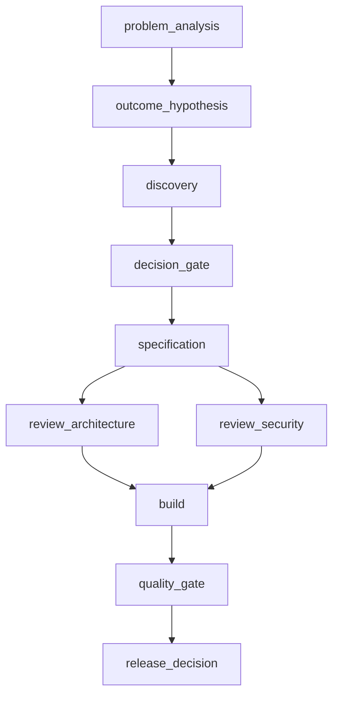

# Parallel Agent Execution Guide (EVO-028)

DAG-based parallel agent execution reduces end-to-end value stream latency by **20–50%** by running independent stages and reviewers concurrently while strictly preserving dependency order, resource bounds, and output determinism.

---

## How Parallelism Works

The orchestrator models agents as a Directed Acyclic Graph (DAG) via NetworkX (`DependencyGraph`) and executes topological layers sequentially while launching independent agents within each layer concurrently via `asyncio.gather`:

```
Layer 0: problem_analysis
           │
Layer 1: outcome_hypothesis
           │
Layer 2: discovery
           │
Layer 3: decision_gate
           │
Layer 4: specification
           │
           ├───▶ review_architecture   ┐
           ├───▶ review_security       │ Layer 5 (concurrent)
           ├───▶ review_performance    │
           └───▶ review_maintainability┘
           │
Layer 6: build  (or concurrent with Layer 5 when parallel_build_with_review=true)
           │
Layer 7: quality_gate
           │
Layer 8: release_decision
```

### Amdahl's Law Speedup

For a workflow with parallelizable fraction `P` across `N` concurrent workers:

- `Speedup = 1 / ((1 - P) + P / N)`
- Example multi-review stage: Architecture (`30s`), Security (`25s`), Performance (`20s`), Maintainability (`15s`)
  - Sequential review duration: `90s`
  - Parallel review duration: `max(30s, 25s, 20s, 15s) = 30s` (**66.7% faster review stage**)

Core modules:
- [src/product_value_system/orchestrator/dependency_graph.py](../src/product_value_system/orchestrator/dependency_graph.py) — `DependencyGraph`, `AgentDefinition`, `ExecutionLayer`, `ResourceRequirements`, `build_dependency_graph()`
- [src/product_value_system/orchestrator/parallel_executor.py](../src/product_value_system/orchestrator/parallel_executor.py) — `ParallelExecutor`, `ExecutionResult`, `ParallelExecutionSummary`
- [src/product_value_system/orchestrator/resource_manager.py](../src/product_value_system/orchestrator/resource_manager.py) — `ResourceManager`, `ResourceSnapshot`, `ResourceLimitError`
- [src/product_value_system/orchestrator/conflict_resolver.py](../src/product_value_system/orchestrator/conflict_resolver.py) — `ConflictResolver`, `ConflictStrategy`, `ConflictRecord`, `ResolutionReport`
- [src/product_value_system/orchestrator/controller.py](../src/product_value_system/orchestrator/controller.py) & [value_stream_orchestrator.py](../src/product_value_system/orchestrator/value_stream_orchestrator.py) — `ValueStreamOrchestrator` integration
- [config/orchestrator.yaml](../config/orchestrator.yaml) — YAML configuration

---

## Declaring Agent Dependencies

Define each agent's upstream dependencies, optional parallel allow/deny constraints, output grouping, and resource profile with `AgentDefinition`:

```python
from product_value_system.orchestrator import (
    AgentDefinition,
    ResourceRequirements,
    build_dependency_graph,
)

dag = build_dependency_graph(
    [
        AgentDefinition(name="specification", depends_on=[]),
        AgentDefinition(
            name="review_architecture",
            depends_on=["specification"],
            output_type="review",
            priority=2,
            resource_requirements=ResourceRequirements(memory_mb=256, llm_calls=1),
        ),
        AgentDefinition(
            name="review_security",
            depends_on=["specification"],
            output_type="review",
            priority=3,
            resource_requirements=ResourceRequirements(memory_mb=256, llm_calls=1),
        ),
        AgentDefinition(
            name="build",
            depends_on=["review_architecture", "review_security"],
        ),
    ]
)

for layer in dag.get_execution_layers():
    print(f"Layer {layer.layer_number}: {layer.agents}")
```

### Executing a DAG with `ParallelExecutor`

```python
import asyncio
from product_value_system.orchestrator import (
    ConflictResolver,
    ParallelExecutor,
    ResourceManager,
)

async def main() -> None:
    executor = ParallelExecutor(
        resource_manager=ResourceManager(
            max_concurrent_llm_calls=10,
            max_memory_mb=2000,
            llm_rate_limit_per_minute=100,
        ),
        conflict_resolver=ConflictResolver(strategy="merge"),
        max_concurrent=5,
        fallback_to_sequential=True,
    )
    summary = await executor.execute_with_summary(
        dependency_graph=dag,
        initial_inputs={"problem": {"id": "prob-001"}},
        agent_registry=agent_instances,
    )
    print(f"Speedup: {summary.speedup:.2f}x (peak concurrent={summary.peak_concurrent_agents})")

asyncio.run(main())
```

### Enabling Parallel Execution in `ValueStreamOrchestrator`

```python
from product_value_system.orchestrator import ValueStreamOrchestrator

orchestrator = ValueStreamOrchestrator(
    agents=agents,
    evaluation_pipeline=eval_pipeline,
    policy_engine=policy_engine,
    checkpoint_manager=checkpoint_manager,
    artifact_root=artifact_root,
    parallel_config="config/orchestrator.yaml",
)
run = await orchestrator.execute_run(problem)
```

---

## Configuration & Performance Tuning (`config/orchestrator.yaml`)

```yaml
orchestrator:
  parallel_execution:
    enabled: true
    max_concurrent_agents: 5
    max_concurrent_llm_calls: 10
    llm_rate_limit_per_minute: 100
    memory_limit_mb: 2000
    conflict_strategy: merge       # 'merge', 'priority', or 'manual'
    fallback_to_sequential: true
```

Tuning guidelines:
- **`max_concurrent_agents`**: Start at `4–5` for review stages; increase only when downstream API quotas allow.
- **`max_concurrent_llm_calls` & `llm_rate_limit_per_minute`**: Keep aligned with your provider tier RPM limit to avoid `HTTP 429` throttling.
- **`memory_limit_mb`**: Each running agent reserves its declared `ResourceRequirements.memory_mb`. Waiters block asynchronously on `asyncio.Condition` (deadlock-free) until completed peers release memory.
- **`conflict_strategy`**:
  - `merge`: Deep-merges dicts and deduplicates lists; resolves review verdicts conservatively (`reject` > `request_changes` > `approve`).
  - `priority`: Selects the full output of the highest-priority agent.
  - `manual`: Preserves all conflicting outputs under `candidates` and sets `requires_manual_review = True`.

---

## Visualizing the Dependency Graph

Export a Mermaid flowchart directly from any `DependencyGraph` or `ValueStreamOrchestrator`:

```python
dag = orchestrator.build_dependency_graph()
print(dag.visualize())
```

Example output:



---

## Troubleshooting & Rollback

- **Instant rollback to sequential execution**: Set `orchestrator.parallel_execution.enabled: false` in [config/orchestrator.yaml](../config/orchestrator.yaml), or pass `config={"enable_parallel_execution": False}` on an individual run.
- **`ValueError: Dependency graph has cycles`**: Inspect the cycle list printed in the error message and remove circular `depends_on` references.
- **`ResourceLimitError`**: A single agent requested more `memory_mb` or `llm_calls` than the total configured `memory_limit_mb` / `max_concurrent_llm_calls`. Increase the budget or lower the agent's requirement.
- **Partial layer failures**: Exceptions in one agent are isolated (`asyncio.gather(..., return_exceptions=True)`), so peer agents in the same layer still finish cleanly and downstream consumers receive `missing_dependencies` metadata.

---

## Related Documentation

- [Architecture & Diagrams](ARCHITECTURE.md)
- [Multi-Agent Review Guide](review-guide.md)
- [Batch Evaluations Guide](batch-evaluations.md)
- [Model Routing Guide](model-routing.md)
- [Cost Management](COST_MANAGEMENT.md)
