# Incident Troubleshooting Flowchart

Use this decision tree to jump directly from a firing alert or symptom to the exact remediation runbook in under 60 seconds.

```mermaid
flowchart TD
    START["Alert Fires / User Report"] --> CAT{"Primary Symptom Category?"}

    CAT -->|"API / SLO"| API{"Which SLO?"}
    API -->|"Availability / 503"| R_UNAVAIL["incident-api-unavailable.md"]
    API -->|"p99 Latency > 1s"| R_LAT["incident-high-latency.md"]
    API -->|"5xx Error Rate > 1%"| R_ERR["incident-high-error-rate.md"]
    API -->|"Agent Success < 95%"| R_AGENT["incident-agent-success-drop.md"]

    CAT -->|"Database"| DB{"DB Failure Mode?"}
    DB -->|"Primary Down / Failover"| R_PGDOWN["incident-database-primary-down.md"]
    DB -->|"Pool Exhausted"| R_POOL["incident-database-connection-exhaustion.md"]
    DB -->|"Slow Queries > 100ms"| R_SLOW["incident-slow-queries.md"]
    DB -->|"Standby Lag > 1MB"| R_LAG["incident-replication-lag.md"]
    DB -->|"Backup / Restore Alert"| R_BKP["incident-backup-failure.md"]

    CAT -->|"Kubernetes / Infra"| K8S{"Resource Symptom?"}
    K8S -->|"CrashLoopBackOff"| R_CRASH["incident-pod-crashloop.md"]
    K8S -->|"OOMKilled / Mem > 90%"| R_OOM["incident-oom-kill.md"]
    K8S -->|"CPU Throttled"| R_CPU["incident-high-cpu-usage.md"]
    K8S -->|"Disk >= 90%"| R_DISK["incident-disk-full.md"]

    CAT -->|"AI / Security / Ops"| OPS{"Subsystem?"}
    OPS -->|"LLM 5xx / Timeout"| R_LLM["incident-llm-provider-outage.md"]
    OPS -->|"LLM 429 Quota"| R_RATE["incident-llm-rate-limit.md"]
    OPS -->|"Budget / EMERGENCY_STOP"| R_FIN["incident-budget-exhaustion.md"]
    OPS -->|"Cache Miss / Redis Down"| R_CACHE["incident-cache-degradation.md"]
    OPS -->|"Vault Sealed / Leases"| R_VAULT["incident-vault-sealed.md"]
    OPS -->|"Sandbox Egress Block"| R_SBOX["incident-sandbox-egress-block.md"]
    OPS -->|"HMAC Tamper Alert"| R_AUDIT["incident-audit-tamper-alert.md"]
```

---

## Direct Links by Category

- **API & SLO**: [API Unavailable](incident-api-unavailable.md) · [High Latency](incident-high-latency.md) · [High Error Rate](incident-high-error-rate.md) · [Agent Success Drop](incident-agent-success-drop.md)
- **Database & DR**: [Primary Down](incident-database-primary-down.md) · [Connection Exhaustion](incident-database-connection-exhaustion.md) · [Slow Queries](incident-slow-queries.md) · [Replication Lag](incident-replication-lag.md) · [Backup Failure](incident-backup-failure.md) · [Emergency Data Loss](emergency-data-loss.md)
- **Kubernetes**: [Pod CrashLoop](incident-pod-crashloop.md) · [OOM Kill](incident-oom-kill.md) · [High CPU](incident-high-cpu-usage.md) · [Disk Full](incident-disk-full.md)
- **AI, Secrets & Compliance**: [LLM Outage](incident-llm-provider-outage.md) · [LLM Rate Limit](incident-llm-rate-limit.md) · [Budget Exhaustion](incident-budget-exhaustion.md) · [Cache Degradation](incident-cache-degradation.md) · [Vault Sealed](incident-vault-sealed.md) · [Sandbox Egress Block](incident-sandbox-egress-block.md) · [Audit Tamper Alert](incident-audit-tamper-alert.md) · [Emergency Security Breach](emergency-security-breach.md)
