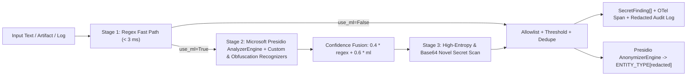

# Secret Detection Architecture (Presidio ML + Regex)

## Overview

The AI-Native Product Value System enforces a **3-stage hybrid secret detection pipeline** (`HybridSecretDetector` + `MLSecretDetector`) combining sub-10ms deterministic regex scanning with **Microsoft Presidio** (`AnalyzerEngine` + `AnonymizerEngine`), custom AI/cloud/crypto recognizers, obfuscation de-obfuscation, and Shannon entropy/Base64 analysis.



## Presidio Integration

### Custom Cloud, AI & Crypto Recognizers

When `product-value-system[security-ml]` is installed, `MLSecretDetector` registers dedicated Presidio `PatternRecognizer` and `EntityRecognizer` implementations (excluding unrelated PII recognizers for speed and precision):

| Entity Type | Provider / Target | Detection Pattern / Strategy |
|---|---|---|
| `OPENAI_API_KEY` | OpenAI | `sk-proj-...`, `sk-svcacct-...`, `sk-admin-...`, and legacy `sk-...` (20+ chars) |
| `ANTHROPIC_API_KEY` | Anthropic Claude | `sk-ant-...` (including `sk-ant-api03-...` snapshots) |
| `AWS_ACCESS_KEY` | Amazon Web Services | IAM/STS `AKIA...` and `ASIA...` (20 chars) |
| `AWS_SECRET_ACCESS_KEY` | Amazon Web Services | 40-char Base64 secret assignments with AWS context |
| `GCP_SERVICE_ACCOUNT` | Google Cloud Platform | JSON `"private_key"` PEM blocks & `AIza...` API keys |
| `GITHUB_TOKEN` | GitHub | Classic `ghp_`/`gho_`/`ghu_`/`ghs_`/`ghr_` & fine-grained `github_pat_` |
| `AZURE_API_KEY` | Microsoft Azure | Storage `AccountKey=...` & Azure OpenAI/Cognitive key assignments |
| `SLACK_TOKEN` | Slack | Bot/app/user `xox[baprs]-...` tokens |
| `PRIVATE_KEY` | Cryptographic PEM | RSA / EC / OpenSSH private key headers |
| `BEARER_TOKEN` | HTTP Auth / JWT | `Bearer <token>` headers and JWT signatures |
| `GENERIC_API_KEY` / `PASSWORD` / `CREDIT_CARD` | Generic / PCI | High-entropy key/password assignments & Luhn-validated card numbers |
| `ObfuscatedSecretRecognizer` | Multi-Provider Evasion | Spaced/character-separated, hex-escaped (`\xHH`), string-concatenated (`"a" + "b"`), URL-encoded (`%2D`), and Base64-encoded credentials |

### Confidence Score Fusion

Overlapping regex and Presidio ML findings are combined with deterministic weighted fusion:

$$\text{confidence}_{\text{hybrid}} = 0.4 \cdot \text{confidence}_{\text{regex}} + 0.6 \cdot \text{confidence}_{\text{ml}}$$

- Findings detected only by Presidio / `ObfuscatedSecretRecognizer` retain `source="ml"`.
- Findings confirmed by both stages emit `source="hybrid"`.
- Findings below `confidence_threshold` (default `0.7`) are suppressed before returning or redacting.
- Surrounding context windows discount synthetic documentation examples, unit-test fixtures, UUIDs, Docker image digests, and Git commit SHAs.

### Lean spaCy Pipeline Optimization

To keep CPU latency well below the `< 100 ms` p50 target on 10KB documents while retaining Presidio's `LemmaContextAwareEnhancer` context boosting:

1. `MLSecretDetector` loads `en_core_web_sm` (falling back automatically to `en_core_web_lg` if installed), disables unused heavyweight pipes (`tok2vec`, `tagger`, `parser`, `attribute_ruler`, `lemmatizer`, `ner`), and attaches a lightweight `pvs_fast_lower_lemma` component.
2. The loaded `SpacyNlpEngine` is cached process-wide so subsequent `HybridSecretDetector` instantiations incur near-zero overhead.

## Installation & Configuration

### Install Optional Presidio ML Support

```bash
pip install -e ".[security-ml]"
python -m spacy download en_core_web_sm
# Optional larger model (automatically detected if installed):
# python -m spacy download en_core_web_lg
```

### Environment Variables (`.env`)

```bash
SECRET_DETECTION_USE_ML=true          # Enable Presidio ML detection
SECRET_DETECTION_CONFIDENCE=0.7       # Minimum confidence threshold (0.0-1.0)
```

### Python SDK Usage

```python
from product_value_system.security import HybridSecretDetector

# Default hybrid ML mode (uses Presidio when installed)
detector = HybridSecretDetector(use_ml=True, confidence_threshold=0.7)
findings = detector.find_secrets(payload)

# Structured anonymization via Presidio AnonymizerEngine -> "OPENAI_API_KEY[redacted]"
safe_text = detector.anonymize(payload)

# Or initialize directly from environment variables
env_detector = HybridSecretDetector.from_env()

# Fast backward-compatible regex-only mode (never loads Presidio/spaCy)
fast_detector = HybridSecretDetector(use_ml=False)
```

### ReDoS-Safe Allowlists & YAML Configuration

Configure entity scopes and allowlists in [`config/secret_detection.yaml`](../../config/secret_detection.yaml) and [`config/secret_detection_allowlist.yaml`](../../config/secret_detection_allowlist.yaml). Literal allowlist patterns are escaped automatically; optional `regex:` allowlist entries are validated by `validate_allowlist_pattern()` to reject nested quantifiers and overly long patterns (>256 chars).

## Graceful Degradation

- If `presidio-analyzer` or `presidio-anonymizer` is not installed:
  - `HybridSecretDetector(use_ml=True)` logs a single warning (`pip install product-value-system[security-ml]`), sets `presidio_enabled = False`, and falls back cleanly to the built-in zero-dependency `ml_classifier` backend so CI pipelines without spaCy keep contextual FP filtering and obfuscation scanning.
  - `HybridSecretDetector(use_ml=True, require_presidio=True)` forces `use_ml = False` and falls back directly to pure regex-only detection (`source="regex"`).
- `HybridSecretDetector(use_ml=False)` remains 100% backward-compatible and never imports Presidio or spaCy.

## Security & Observability Controls

- **Zero Secret Logging**: Audit events (`secret_detection.audit`) log only counts, entity types, sources, active backend, and latency in ms — raw secret values are never logged.
- **OpenTelemetry Spans**: `find_secrets()` emits a `secret_detection.scan` span with non-sensitive attributes (`secret_detection.use_ml`, `secret_detection.backend`, `secret_detection.text_length`, `secret_detection.findings_count`, `secret_detection.latency_ms`).

## Performance Characteristics

Measured on Python 3.12 (CPU, Windows 11) via `pytest tests/security/test_hybrid_detector_ml.py`:

| Mode | Input Size | Target | Measured Result |
|---|---:|---:|---:|
| Regex-only (`use_ml=False`) | 10 KB | p50 `< 10 ms` | `0.50 ms` p50 (`0.57 ms` max) |
| Presidio ML (`use_ml=True`) | 10 KB | p50 `< 100 ms`, p99 `< 500 ms` | `7.86 ms`–`8.72 ms` p50 (`< 21 ms` max) |
| Presidio ML (`use_ml=True`) | 50 KB (~10K tokens) | `< 100 ms` | `~20 ms` p50 |
| Obfuscation Corpus Recall | 12 obfuscated patterns | `> 95%` | `100%` (12/12) |
| Benign Corpus FPR | 1,000 engineering docs | `< 1%` | `0.0%` (0/1,000) |

## Troubleshooting

1. **Missing spaCy model**: Run `python -m spacy download en_core_web_sm` (12.8 MB) or `en_core_web_lg`.
2. **Disable ML temporarily**: Set `SECRET_DETECTION_USE_ML=false` or pass `--regex-only` to `python -m product_value_system.security.detect_secrets`.
3. **Inspect active backend**: Check `detector.ml_backend` (`"presidio"`, `"ml_classifier"`, or `"regex"`) and `detector.presidio_enabled`.

---

See also: [Secret Management Guide](../SECRET_MANAGEMENT.md) · [ADR-0005](../adr/ADR-0005-zero-trust-sandbox-egress-and-hybrid-secret-detection.md)
